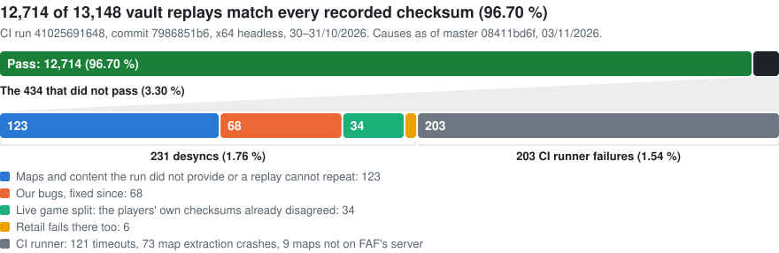

<div align="center">

# faf-re

**The *Supreme Commander: Forged Alliance* engine, rebuilt as C++20**

[](docs/RETAIL_REPLAY_PARITY.md)
[](docs/PERFORMANCE.md)
[](#build)

[Build](#build) · [Retail parity](#retail-parity) · [Performance](#performance) · [Contributing](CONTRIBUTING.md)

</div>

The Moho engine behind *Supreme Commander: Forged Alliance* (2007), rebuilt as readable, buildable C++20 so it can be maintained instead of staying frozen in a binary. It builds for x86 and x64, plays real games bit for bit like the retail `ForgedAlliance.exe`, and the x64 build plays replays about a quarter faster.

> An independent preservation and interoperability effort, inspired by and indebted to the [Forged Alliance Forever](https://faforever.com) community. Not affiliated with, endorsed by, or supported by the original publisher or developer. See [LEGAL.md](LEGAL.md).

## Status

| | |
|---|---|
| Renderers | [](docs/RENDERER_BACKENDS.md) [](docs/RENDERER_BACKENDS.md) [](docs/RENDERER_BACKENDS.md) [](docs/RENDERER_BACKENDS.md) [](docs/RENDERER_BACKENDS.md) |
| Replay parity | 12,714 of 13,148 vault replays (96.7 %) match every recorded checksum on CI (30–31/10/2026), 12,783 (97.2 %) with the fixes since; none is known to fail because of the engine ([Retail replay parity](docs/RETAIL_REPLAY_PARITY.md)) |
| Live multiplayer | Retail, rebuilt x86 and rebuilt x64 in one game: 21 min of AI-driven fighting without a desync; retail and our x64 also ran 30 min without a desync, with and without sim workers |
| Performance | x64 replays take 19 % less time than retail on average (4 % to 33 %) ([Performance](docs/PERFORMANCE.md)) |
| Recovery | Complete: every engine function the game uses is written as source (40,617 functions). The rest of the shipped exe is library code we link from source (wxWidgets, the MSVC runtime, libpng, Wild Magic, ...) or unreferenced fragments; 0 functions are outstanding |

Most symbols in the retail engine were never hand-written: they are template instantiations, folded aliases, unwind glue and static-init thunks the 2007 compiler emitted from a single source line. Those are rebuilt as that one line, so the function count understates how much is covered.

## Retail parity

Real games from the FAF replay vault (stock and community maps, 1–12 human players, games against the built-in AI and M28AI) play back on the rebuilt engine checksum-identical to retail. The largest run played 13,148 replays:

<picture>
  <source media="(prefers-color-scheme: dark)" srcset="docs/images/parity-overview-dark.svg">
  
</picture>

Every desync has a known cause. Counting the fixes, 12,783 of 13,148 (97.22 %) should pass on master. That number is worked out, not measured: no full run has played the new build yet. All 34 live splits were played on retail: 33 give our hashes, and 1 differs because of a defect in retail's replay path that the rebuilt engine fixes. Method, per-replay results and the causes of past divergences: [docs/RETAIL_REPLAY_PARITY.md](docs/RETAIL_REPLAY_PARITY.md).

## Performance

- **Against retail**: on five vault replays the x64 build saves 4 % (least), 33 % (most) and 19 % (average) of the time. The bigger the battle, the bigger the gain.
- **Scale**: x86 runs out of address space at about 60,000 units; x64 was still running at 90,000.
- **Exact**: sim work runs on worker threads only where the result is provably the same as serial, and every change has a switch that restores the original code ([docs/SWITCHES.md](docs/SWITCHES.md)).

Numbers, method and what is next: [docs/PERFORMANCE.md](docs/PERFORMANCE.md).

## Desync diagnostics

When a multiplayer game desyncs, three aids show why.

- **Desync recorder** (on by default in live multiplayer games, `/nodesyncdump` turns it off): keeps the state each beat hashes for the recent beats in memory, copied as bytes, and after a checksum mismatch writes a `desync_<game id>_beat<N>_army<A>.zip` dump into the folder of the game's log file. The game log names that folder when a game starts. `/desyncrecorder` records the full sync log instead, at a sim-time cost.
- **Dump compare** (`tools/desync-diff/desync_diff.py`): two players' dumps in, the first value that differs out: beat, entity, field.
- **Telemetry** (on by default in live multiplayer games, `/notelemetry` turns it off): one small OpenTelemetry log record per desync and per game end, without player names, user ids or paths, and the desync dump as `.tar.gz`, sent to the faf-re desync server (`fafre-metrics.draiget.dev`). Unlike the records, a dump holds player names and the game's sync log. `/telemetryendpoint URL` and `/telemetrydumpendpoint URL` send to a server of your own instead; `tools/desync-server` is one, ready for Docker Compose or Kubernetes.

Setting up the collector and the receiver, and what they receive: [docs/DESYNC_DIAGNOSTICS.md](docs/DESYNC_DIAGNOSTICS.md). Every switch and field: [docs/SWITCHES.md](docs/SWITCHES.md#desync-telemetry).

## Build

Windows, with CMake and clang-cl, for x64 and x86. The C/C++ runtime is linked statically, so the executables need no MSVC runtime DLLs.

### Requirements

- **[LLVM](https://github.com/llvm/llvm-project/releases)** in `C:\Program Files\LLVM`, or set `LLVM_ROOT`. CI uses 22.1.7.
- **Visual Studio 2022** with the C++ workload. The build uses its MSVC headers and static libraries and the Windows SDK, not the IDE. Visual Studio Build Tools 2022 with the C++ workload should work too, but has not been tested.
- **CMake 3.25+ and Ninja**, on `PATH` or from Visual Studio's "C++ CMake tools for Windows" component.
- **Git**.

Visual Studio 18 does not work: its static runtime imports a DLL that the `headless` import check refuses, which fails the build. If both versions are installed, build from a Visual Studio 2022 developer prompt; otherwise the build picks the newest one.

### Building

```powershell
git clone --recursive https://github.com/Draiget/faf-re.git
cd faf-re
.\build.ps1
```

This builds x64 Release and copies `main_x64.exe` with its `.pdb`, the `fafengine\` hook folder and the DXC DLLs into `C:\ProgramData\FAForever\bin_x64`, replacing the exe the FAF client launches. Use `-Name` to keep that exe.

| Command | Result |
|---|---|
| `.\build.ps1 -Arch both` | x64 and x86 (x86 goes to `C:\ProgramData\FAForever\bin\main.exe`) |
| `.\build.ps1 -Arch x86 -Name main_test` | another exe name, to keep the current build alongside |
| `.\build.ps1 -NoBuild` | copies the last build only |

Other options: `-Configuration Debug`, `-Profile` (see [Profiling with Tracy](#profiling-with-tracy)), `-FafDir`, `-Out` (also copy into `out\<arch>\`), `-NoCopy`, `-Rebuild`, `-Jobs`.

Without `build.ps1`, using the presets in `CMakePresets.json`:

```powershell
cmake --preset clang-x64-release
cmake --build --preset clang-x64-release   # build/clang-x64-release/src/main_x64.exe
```

### Dependencies

Configuring brings `dependencies/` up to date: it clones missing submodules, fetches missing downloads pinned by commit or SHA256, and applies the FAF patches in `dependencies/patches/`. The full list is in [Libraries the engine uses](#libraries-the-engine-uses). `cmake -P cmake/FafDependencies.cmake` does the same without configuring.

### IDEs

- **Visual Studio 2022:** File → Open → Folder, then pick a preset.
- **VS Code:** install the recommended extensions (CMake Tools, C/C++). CMake Tools offers the same presets, and IntelliSense reads the configured preset.

### Profiling with Tracy

A profile build adds [Tracy](https://github.com/wolfpld/tracy) 0.14.1 instrumentation: zones for the sim beat and its phases, the sim and UI Lua garbage collection, the worker pool tasks, rendering, `Present`, the UI and UDP send/receive, a frame mark per rendered frame and per sim beat, thread names, and every engine allocation and free.

```powershell
.\build.ps1 -Profile    # or build_profile.bat; -> bin_x64\main_x64_profile.exe
.\run_tracy.bat         # the Tracy profiler; downloads it into tools\tracy\ on first run
```

A profile build is copied as `main_x64_profile.exe` (x86: `main_profile.exe`), so it never replaces the exe the FAF client launches; `-Name` picks another name. Without `build.ps1`: `cmake --preset clang-x64-profile; cmake --build --preset clang-x64-profile` (also `clang-x86-profile`). The preset sets `FAF_ENABLE_TRACY=ON`, and configuring fetches Tracy from GitHub.

The client collects only while a profiler is connected (`TRACY_ON_DEMAND`): start the game, then connect from the profiler; it listens on port 8086. Engine code uses the `FAF_PROFILE_*` macros from `src/gpg/core/profiling/Profiler.h`. In every other build they compile to nothing, so release builds are unchanged.

## What is and isn't here

- **Here:** C++ source, build files, and the tooling used to check behaviour against the original.
- **Not here:** any game binary, executable, asset, map, script or other copyrighted content, and nothing derived from them. `bin/`, `dumps/`, `decomp/`, `output/` and `gamedata/` are excluded by design. **You need your own legitimately obtained copy of the game.** Nothing here distributes, circumvents or replaces it.

## Layout

| Path | What |
|---|---|
| `src/` | The engine (`moho`, `gpg`, `legacy`, `lua`, `platform`, ...); source list `src/sources.cmake` |
| `data/fafengine/` | Engine-owned Lua hooks copied next to the exe (for example the Graphics API option) |
| `tools/` | Go multiplayer test harness (`mpemu`) and checkers; see [tools/README.md](tools/README.md) |
| `scripts/` | Sampling profiler, benchmark and replay helpers (`perf/`), shader and texture checks (`effects/`), and the hang stack dumper (`stackdump.cpp`) |
| `docs/` | [Performance](docs/PERFORMANCE.md), [Simulation bottlenecks](docs/RESEARCH_PERF_BOTTLENECKS.md), [Switches](docs/SWITCHES.md), [Retail replay parity](docs/RETAIL_REPLAY_PARITY.md), [PR replay check](docs/PR_REPLAY_CHECK.md), [Renderer backends](docs/RENDERER_BACKENDS.md), [SFD compatibility](docs/FAF_SFD_COMPATIBILITY.md), [Desync diagnostics](docs/DESYNC_DIAGNOSTICS.md) |

## Libraries the engine uses

CMake configure fetches all of them at the exact version below and applies the patches from `dependencies/patches/` where noted. All are compiled from source for x86 and x64, except the DirectX Shader Compiler and the DirectX SDK, which come as Microsoft's prebuilt files.

| Library | Version | Source | FAF patch |
|---|---|---|---|
| Wild Magic | 3.8 (original 2006 release) | [Draiget/wild-magic-3-8](https://github.com/Draiget/wild-magic-3-8) (submodule) | `wildmagic3p8_faf_required` |
| wxWidgets (MSW) | 2.4.2 | [wxMSW-2.4.2.zip](https://github.com/wxWidgets/wxWidgets/releases/download/v2.4.2/wxMSW-2.4.2.zip) | `wxwindows_2_4_2_faf_required`, `_x64`, `_x64_pointers` |
| Boost | 1.34.1 | [boost_1_34_1.tar.bz2](https://downloads.sourceforge.net/project/boost/boost/1.34.1/boost_1_34_1.tar.bz2) | `boost_1_34_1_faf_required` |
| zlib | 1.2.3 | [madler/zlib](https://github.com/madler/zlib/tree/v1.2.3) (submodule) | `zlib_1_2_3_faf_required` |
| FFmpeg | 7.1.3 (LGPL) | [Draiget/ffmpeg-mirror](https://github.com/Draiget/ffmpeg-mirror) (submodule) | none; linked statically, for SFD movies in place of CRI Sofdec/ADX. Configuration and licence: [SFD compatibility](docs/FAF_SFD_COMPATIBILITY.md#ffmpeg-dependency-and-build) |
| FX11 | bec3b8fc | [microsoft/FX11](https://github.com/microsoft/FX11) (submodule) | none |
| Vulkan headers | 1.4.304 | [KhronosGroup/Vulkan-Headers](https://github.com/KhronosGroup/Vulkan-Headers) (submodule) | none |
| libjuice | 1.7.4 (MPL-2.0) | [v1.7.4 source archive](https://github.com/paullouisageneau/libjuice/archive/refs/tags/v1.7.4.tar.gz) | none; built by `cmake/deps/libjuice` as the ICE agent of `src/netlink` |
| libdatachannel | 0.24.6 (MPL-2.0) | [v0.24.6 source archive](https://github.com/paullouisageneau/libdatachannel/archive/refs/tags/v0.24.6.tar.gz) | none; built by `cmake/deps/libdatachannel` without media and WebSocket, on `faf_juice`, for WebRTC data channels (#238) |
| usrsctp | commit fec583d5, the one libdatachannel 0.24.6 pins (BSD-3-Clause) | [commit archive](https://github.com/sctplab/usrsctp/archive/fec583d54493f879d2ae44a743423bf8a04371ab.tar.gz) | none; SCTP for libdatachannel, without IPv4/IPv6 sockets |
| plog | commit 94899e0b, the one libdatachannel 0.24.6 pins (MIT) | [commit archive](https://github.com/SergiusTheBest/plog/archive/94899e0b926ac1b0f4750bfbd495167b4a6ae9ef.tar.gz) | none; headers only, libdatachannel's log |
| Mbed TLS | 3.6.7 LTS (Apache-2.0 or GPL-2.0-or-later; used under Apache-2.0) | [release archive](https://github.com/Mbed-TLS/mbedtls/releases/download/mbedtls-3.6.7/mbedtls-3.6.7.tar.bz2) | none; DTLS for libdatachannel, `MBEDTLS_SSL_DTLS_SRTP` turned on through `cmake/deps/libdatachannel/faf_mbedtls_config.h` |
| Monocypher | 4.0.2 (BSD-2-Clause or CC0, at the user's choice) | [4.0.2 source archive](https://github.com/LoupVaillant/Monocypher/archive/refs/tags/4.0.2.tar.gz) | none; encrypts and authenticates the [net channel](docs/NET_CHANNEL.md)'s datagrams |
| DirectX Shader Compiler | 1.9.2609 | [DXC release](https://github.com/microsoft/DirectXShaderCompiler/releases/tag/v1.9.2609) | none |
| DirectX SDK | June 2010 | an installed SDK, else extracted from [Microsoft's installer](https://download.microsoft.com/download/A/E/7/AE743F1F-632B-4809-87A9-AA1BB3458E31/DXSDK_Jun10.exe) | none |

Lua is part of the engine source: it carries the Lua 5.0 C API headers of LuaPlus build 1081 (`src/lua/luaplus/`), not the LuaPlus library. The original's BugSplat crash reporter is not used. Graphics: Direct3D 9 and 10 as shipped, plus Direct3D 11, Direct3D 12 and Vulkan added here.

## SFD movie playback

The engine does not use or distribute the CRI Sofdec/ADX runtime. `.sfd` support is an independent implementation with FFmpeg and a bounded FAF metadata parser. The legacy `mwPly*`/`ADXM_*` names remain only as a compatibility facade for the recovered call sites. Embedded audio and optional external XACT sound/voice cues stay separate. Profile, dependency setup, validation and unsupported composition modes: [docs/FAF_SFD_COMPATIBILITY.md](docs/FAF_SFD_COMPATIBILITY.md).

## Support

This rebuild took a lot of time and paid AI compute. If it is useful to you, donations in ETH are welcome: `0x8f614802906dF231b8fbC9a6f11C6728D2A13DDF`

## Credits

Built on many years of engine study by the Forged Alliance Forever community. Particular thanks to [Hdt80bro](https://github.com/Hdt80bro) and [4z0t](https://github.com/4z0t).
