# Peer-to-peer network: measurements before and after

How the game's own network between players behaved before and after the changes behind `net_FlushBeats`, `net_MaxSendRate`/`net_MaxBacklog`, `net_FastRetransmit`, `net_LagAuto` and `net_GameChannel` ([Switches](SWITCHES.md#network-transport)), with every number taken from a run whose command is at the end. Server-mode games are measured separately in [SERVER_NETWORK_MEASUREMENTS.md](SERVER_NETWORK_MEASUREMENTS.md).

## Summary

Three groups of players, three answers:

- **Every game, retail players included** (only how this client sends changes): a beat now leaves as soon as it is written instead of 25 ms later, a large order no longer freezes the game, and a lost packet comes back sooner. Median delivery on a 40 ms link went from 67 to 44 ms; a 44,891-byte order went from a 21-second freeze to none.
- **Games where every player runs this engine in native mode:** the game channel replaces the shipped packets inside the old lane. Against the shipped transport, the order delay a network needs fell from 175 to 50 ms on a typical link, from 725 to 300 ms on a bad one, and from "no delay is enough" to 250 ms on the worst one, with 1.6 to 5.8 KB/s per link on the wire (the old lane: 3.0 to 5.4 KB/s; the shipped transport: 1.1 to 1.5 KB/s).
- **The order delay** (500 ms as shipped) stays at 500 ms by default. The bench shows most networks need far less, but two automatic versions pulled the two clients' delays apart in test games, so it is a switch for good links (`net_LagAuto`), not a default; [The order delay](#the-order-delay) has why.

Replays: the core set plays back with every recorded checksum matching on x64 and x86 (one of its replays, 28070914, stops at its game's end before the recording's, as it does on master), and so do all 14 recordings of the two-client test games below: 10 from the games in the table and the game against our released x86 build, and 4 from two earlier builds of this work whose order delay was later changed.

## Bench results

All numbers are from 3 seeds × 60 s per cell. "Retail" is the shipped transport with the shipped values, "lane" our native links before this work, "tuned" the shipped transport with the new defaults (what a game with a retail player gets), "channel" the game channel with the new defaults.

| Network | Retail | Lane | Tuned | Channel |
|---|---|---|---|---|
| Median beat delivery, lan (1 ms) | 28 ms | 29 ms | 4 ms | 4 ms |
| Median beat delivery, typical (40 ms) | 67 ms | 68 ms | 44 ms | 44 ms |
| 99th percentile, bad (80 ms ± 30, 3 % loss) | 346 ms | 232 ms | 339 ms | 197 ms |
| 99th percentile, worst (150 ms ± 50, 5 % loss) | 1,239 ms | 244 ms | 554 ms | 226 ms |
| Order delay needed, typical | 175 ms | 75 ms | 125 ms | 50 ms |
| Order delay needed, bad | 725 ms | 300 ms | 775 ms | 300 ms |
| Order delay needed, worst | none ≤ 1,500 ms | 250 ms | 1,050 ms | 250 ms |
| Stall at the shipped 500 ms, bad | 281 ms/min | 0 | 229 ms/min | 0 |
| Stall at the shipped 500 ms, worst | 1,490 ms/min | 0 | 405 ms/min | 0 |
| A 44,891-byte order (order-burst) | 20,994 ms/min | 20,974 ms/min | 0 | 0 |
| The same order on a 256 kbit/s uplink | 20,984 ms/min | 21,237 ms/min | 3,030 ms/min | 2,645 ms/min |
| 3 s with no connection (outage) | 3,535 ms/min | 2,566 ms/min | 2,680 ms/min | 2,595 ms/min |
| Bytes per second per link, typical | 1,191 | 4,509 | 1,285 | 3,361 |

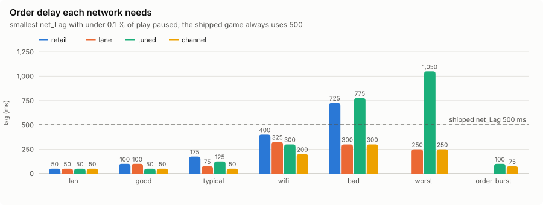

Each bar is the shortest order delay at which the game stands still for less than 0.1 % of play. The dashed line is the shipped 500 ms: the shipped transport needs more than that on the bad and worst networks, so those players see pauses at the shipped delay, and needs far less on the others, so every order there waits longer than it has to.

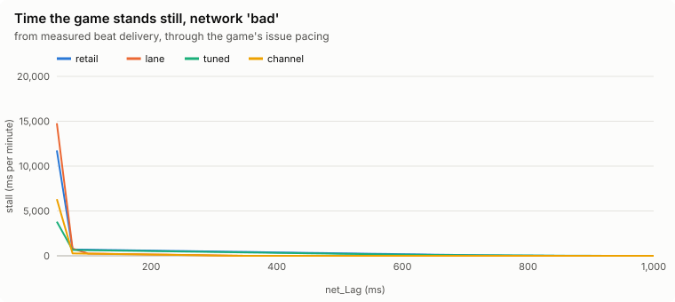

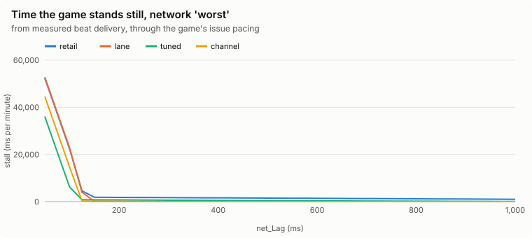

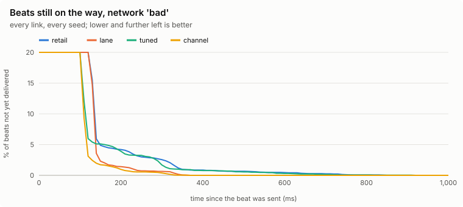

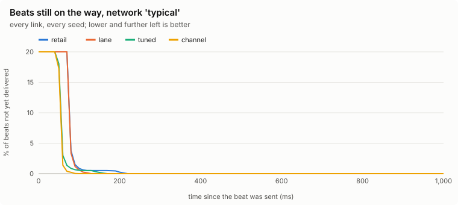

### Every game: when and how fast this client sends

Three changes to the shipped transport, one at a time and together (`tuned`):

| Network | Retail | Beat flush | Fast resend | Rate 65536 | All three |
|---|---|---|---|---|---|
| Median delivery, lan | 28 ms | 4 ms | 28 ms | 29 ms | 4 ms |
| Median delivery, typical | 67 ms | 44 ms | 69 ms | 67 ms | 44 ms |
| Stall at 500 ms, worst | 1,490 ms/min | 677 ms/min | 458 ms/min | 963 ms/min | 405 ms/min |
| Stall at 500 ms, order-burst | 20,994 ms/min | 20,934 ms/min | 20,971 ms/min | 0 | 0 |
| Stall at 500 ms, outage | 3,535 ms/min | 3,497 ms/min | 2,681 ms/min | 3,520 ms/min | 2,680 ms/min |
| Bytes per second per link, typical | 1,191 | 1,237 | 1,283 | 1,192 | 1,285 |

- **Beat flush** (`net_FlushBeats`): the shipped connection holds whatever it is given for `net_SendDelay` (25 ms) so more can join it, and in a running game nothing flushes it (`CNetUDPConnector::Push` runs only in the lobby). A beat is written whole by the issue thread, so the marshaller now flushes the connections right after a beat's end: the 24 ms of waiting go, at the same bytes.
- **Fast resend** (`net_FastRetransmit`, #237): a lost packet's first resend follows the round trip instead of waiting at least 100 ms. On by default now.
- **Rate** (`net_MaxSendRate`, `net_MaxBacklog`): the shipped 2,048 bytes per second per player hold a large order for 21 s, and every later beat waits behind it. 65,536 sends the same order in under a second (#236 measured this in a live game: 21.8 s before, nothing over 0.8 s after).

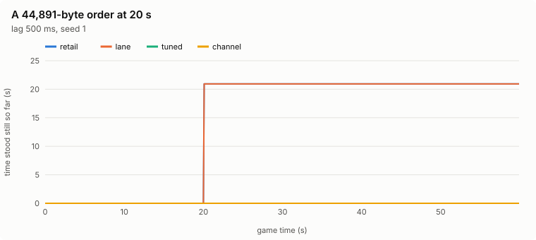

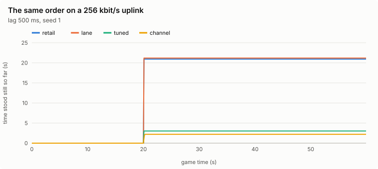

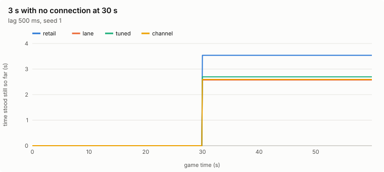

### Between our builds: the game channel

The lane already repaired losses well, but it wrapped the shipped transport, so a beat paid for two layers of acks and headers, the shipped resend timers still ran underneath, and every datagram was repeated whatever it held. The game channel carries the stream itself on a net channel ([NET_CHANNEL.md](NET_CHANNEL.md)):

- one layer of acks with round-trip-based loss detection, no 32-packet window, encrypted with the keys the lane had;
- each new range of the stream goes again while unacked, 30 ms after it was sent, then 60, 120, 240 and 480 ms later (`net_GameChannelRepeats`, `net_GameChannelRepeatMs`), so a burst of losses that swallows the first copies still meets a later one; only while at most 4 KB is in flight, so a large order or a rejoin's save is left to loss detection and doesn't fill a slow uplink several times over;
- the first datagram after half a second of silence (an outage, a route change) sends everything in flight again at once;
- its sends count against `net_MaxSendRate` like the shipped packets, so the connector paces bulk data as it always has.

How many repeats, and when, against bytes:

| Network | No repeats | 2 from 30 ms | 5 from 30 ms (default) | 5 from 60 ms | 5 from 30 ms, only after a loss |
|---|---|---|---|---|---|
| Order delay needed, typical | 175 ms | 50 ms | 50 ms | 75 ms | 125 ms |
| Order delay needed, bad | 625 ms | 600 ms | 300 ms | 550 ms | 275 ms |
| Order delay needed, worst | 900 ms | 250 ms | 250 ms | 325 ms | 200 ms |
| Bytes per second per link, typical | 1,635 | 3,398 | 3,361 | 2,952 | 3,014 |
| Bytes per second per link, worst | 1,582 | 3,645 | 4,699 | 3,704 | 4,709 |

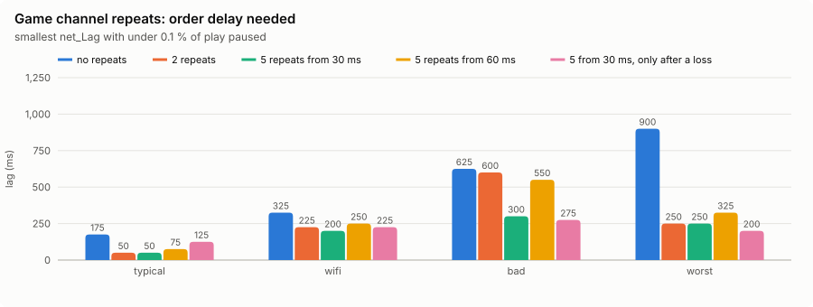

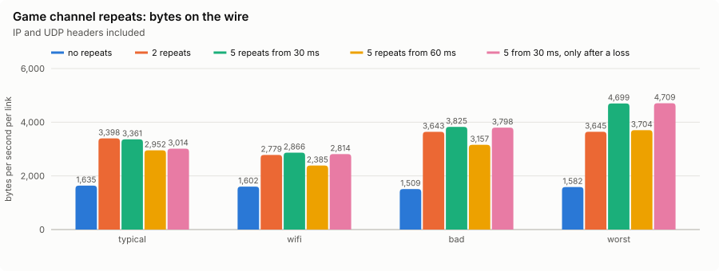

Repeating only after a loss (`net_GameChannelRepeatHoldMs`) saved at most 11 % of the bytes, none on a LAN (where the ack comes back before the first repeat is due). On the bad and worst networks, which lose often enough to keep repeats on, it came out within 50 ms of always repeating (275 and 200 ms against 300 and 250, within what three seeds can tell apart); on the typical network the loss that turns repeats on is the one that then waits, so it needed more than twice the order delay (125 against 50 ms). The default repeats always. Two repeats are enough while losses come one at a time (typical, worst) but not in runs (bad: 3 % in runs of 2), which is what the later, doubling repeats are for.

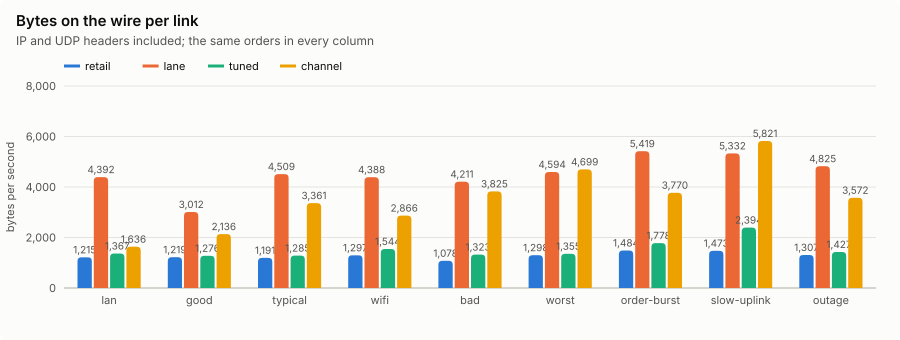

The game channel sends more than the shipped transport: on a link that loses nothing it is about 35 % more (1,636 against 1,215 bytes per second on the LAN, the 32-byte header and tag of an encrypted datagram against the shipped 15), and on lossy links the repeats bring it to 1.8 to 3.6 times as much: less than the lane our native links used before on most networks, about as much on the worst one (4,699 against 4,594 bytes per second), and more on the slow uplink (5,821 against 5,332), where the order's own resends add to it. `net_GameChannelRepeats=0` brings it to about 1.6 KB/s at the cost shown in the first column.

### The order delay

The shipped game sends every beat 500 ms before its turn, so every order waits half a second whatever the network. The bench shows what each network needs: from 50 to 300 ms with the game channel, from 50 to over 1,000 ms with the shipped transport. Setting the delay from what the network does is the obvious next gain, and two automatic versions were tried in the two-client games:

| Version | What a client measured | Typical link: the two clients' delays at the end of the game | Bad link |
|---|---|---|---|
| 1 | the other player's beats, timed from its own sending | 994 and 244 ms | 954 and 309 ms |
| 2 | the round trip, plus a step up for each pause it saw | 1,000 and 700 ms (the second had been down to 150 ms) | 475 and 1,000 ms |

A client's delay has to cover how late its own beats reach the others, and only the others see that. Version 1's timing also holds the difference between the two clients' delays, so each one's change fed the other's. Version 2's pauses are one-sided: the player who waits pauses, and the player whose beats came late carries on, so the one who can't fix it raises its delay and the one who could lowers it. In the first game of version 2 one client counted 11 pauses and climbed to 1,000 ms while the other counted none.

So the delay stays at 500 ms by default. `net_LagAuto` keeps the one input both ends see alike, the round trip: half its 99th percentile plus 100 ms, never over the shipped 500 ms. That suits a good link where both players switch it on. Doing better needs each player to hear how late its beats arrive at the others, through the shared peer announcement (`net_PeerFeatures`), which is off by default so that retail players get no extra message.


## Why replays can't tell the difference

A game is lockstep: every client runs the whole simulation, and only orders travel. The game advances in beats of 100 ms; each beat runs once every player's orders for it have arrived. A replay file holds the game's setup and that stream of orders, and playing it back reads the stream from the file (`CReplayClient`); no connection is opened. Everything below changes when and how the orders' bytes travel between players, never what a beat holds, so a replay recorded with these changes plays on any build, and the vault replays play the same as before. The [core set](PR_REPLAY_CHECK.md) and the games' own recordings below were played back to check it.

The order delay (`net_Lag`) decides how far ahead of its turn a client sends a beat. Lowering it makes an order run sooner; the beat it runs in is still recorded as it happened.

## Terms

| Term | Meaning here |
|---|---|
| Beat | One simulation step; 10 a second at normal speed. Each player sends one per beat: its orders for that beat, a checksum and the beat's end. |
| Order delay (`net_Lag`) | How long before its turn a beat is sent. An order given now runs this much later (plus up to a beat). 500 ms in the shipped game. |
| Delivery | From a beat leaving one player to the other having all of it. |
| Stall | Time the game stood still because some player's beat hadn't arrived by its turn. Players see it as the game freezing. |
| Pause | One stall of 150 ms or more: the stutter a player notices. |
| Shipped transport | `CNetUDPConnection` as in the 2007 game: 497-byte packets, 32 packets in flight, a resend after at least 100 ms, data held 25 ms (`net_SendDelay`) for more to join it, 2,048 bytes per second per player (`net_MaxSendRate`). Retail players and the Java ICE adapter use it. |
| Lane | Native links between our builds before this work (#240): the shipped packets, each repeated inside later datagrams of a net channel until acked. |
| Game channel | This work (`net_GameChannel`): between our builds in native mode, the stream itself travels on a net channel ([NET_CHANNEL.md](NET_CHANNEL.md)) instead of in shipped packets. |
| Wire bytes | Bytes on the network including 28 bytes of IP and UDP header per datagram. |

## Method

### Bench: real connections, simulated network

`faf_netbench` (`tests/net/NetBench.cpp`) runs two of the game's real `CNetUDPConnector`s in one process, joined by in-process links that add one-way latency, jitter (uniform, order kept), loss (independent, or in runs of `burst` datagrams on average), an uplink bandwidth and outages. Each player sends a beat every 100 ms as the game's issue thread does: each order its own message (a Poisson count at 120 actions a minute, 1 to 12 unit ids and a target each), then a 20-byte checksum message, then the end of the beat. The other player's connection times each beat's end as its dispatch delivers it. Nothing is flushed early unless the configuration says so, as in a running game, where nothing calls the connector's `Push` (it waits `net_SendDelay`). The timer resolution is 1 ms, as the game sets it. Each run is 60 s of beats; every cell is 3 seeds.

`tools/netbench/run.py` runs the profiles and configurations below; `tools/netbench/report.py` makes the tables and charts.

| Profile | One way | Jitter | Loss | Other |
|---|---|---|---|---|
| lan | 1 ms | ±0.5 ms | 0 | |
| good | 20 ms | ±3 ms | 0.1 % | |
| typical | 40 ms | ±10 ms | 0.5 % | |
| wifi | 30 ms | ±25 ms | 2 %, in runs of 3 | |
| bad | 80 ms | ±30 ms | 3 %, in runs of 2 | |
| worst | 150 ms | ±50 ms | 5 % | |
| order-burst | 40 ms | ±10 ms | 0.5 % | one 44,891-byte order at 20 s (the burst #236 modelled from replay 27039808) |
| slow-uplink | 40 ms | ±10 ms | 0.5 % | the same order on a 256 kbit/s uplink |
| outage | 40 ms | ±10 ms | 0.5 % | 3 s with nothing getting through either way, at 30 s |

### From delivery times to stalls

A beat that arrives after its turn stalls the game. The game's issue thread (`CSimDriver::ThreadRun`) sends beat k when beat k − m has run, m = ⌈lag / 100⌉, plus 100 m − lag ms, and beat k runs once every player's beat k is in and 100 ms after beat k − 1. The bench sent beat k at S_k = 100 k and the slowest link delivered it d_k later. A beat a stalled game sends later can't get through before the network let it through (it queues behind the same burst, waits out the same outage), nor sooner than the quickest delivery d_min after it was sent:

```
I_k = E(k−m) + 100 m − lag          (I_k = 100 k for the first m beats)
A_k = max(S_k + d_k, I_k + d_min)
E_k = max(E(k−1) + 100, A_k)
stall_k = E_k − (E(k−1) + 100)
```

The stall per minute is the sum of stall_k over the run, per minute of play. "Order delay needed" is the shortest lag, in steps of 25 ms, at which the stall stays under 60 ms a minute (0.1 % of play) with at most one pause in 10 minutes. The same model gives 20,994 ms of stall a minute for the shipped transport in the order-burst profile: one 21-second freeze, as the live game showed in #236 (21.8 s).

### Games

Two of our x64 clients in native mode on one machine, both armies handed to M28AI at its hardest, 8 minutes of play on faf_re_lockstep, the link shaped by mpemu (`shaping: links`) from the start of play. "Before" sets the shipped values (`net_FlushBeats=0;net_LagAuto=0;net_GameChannel=0;net_MaxSendRate=2048;net_MaxBacklog=2048;net_FastRetransmit=0`, so the lane as before); "after" uses the defaults. The clients log every pause (`net_LogShownBeatMs=150`), every late beat (`net_LogBeatWaitMs=150`) and, every 100 beats, how long beats took from being sent to being on screen. Each game's recording was then played back in headless.

| Game (played 2026-11-17/18) | Link | Carrier | Pauses (client 1 / 2) | Time paused | Beats that waited 150 ms or more for the other player | Beat sent to on screen, median |
|---|---|---|---|---|---|---|
| Before, 22:26 | typical | lane | 37 / 24 | 6.4 / 4.4 s | 18 / 26 | 506 / 507 ms |
| After, 00:13 | typical | game channel, encrypted | 19 / 21 | 3.3 / 3.7 s | 28 / 27 | 504 / 504 ms |
| Before, 22:43 | bad | lane | 18 / 20 | 3.0 / 3.7 s | 165 / 165 | 506 / 504 ms |
| After, 00:21 | bad | game channel, encrypted | 21 / 16 | 3.7 / 3.0 s | 86 / 128 | 505 / 506 ms |

Pauses and waits leave out the first 100 beats (loading and the first frames). The "after" games ran this work's defaults: the order delay at its 500 ms default. Every game reached beat 4,500 to 4,630 without a desync.

These games say less than the bench, and the doc leans on the bench for that reason. Two clients and two cheating M28AI armies on one machine make the simulation itself late now and then, and at the shipped 500 ms delay both carriers cover these two links (the bench gives no stall at 500 ms for either), so most of the pauses left are the machine's, not the network's. What the network does show: on the bad link, beats that waited on the other player fell from 165 to 86 and 128 a game. The time from sending a beat to showing it stays at about 505 ms, because the order delay stays at 500 ms by default.

Two more games checked the other kinds of player:

- **Our released x86 build and this one** (2026.11.001-stable, through mpemu's relay on the typical link, M28AI, the transport as shipped since neither end runs native links): no desync to beat 4,510. This one used the new send defaults; it logged 18 pauses (3.2 s) and 87 beats that waited.
- **A retail player and ours** (a retail exe with none of our engine's strings in it, x86, through mpemu's relay on the typical link): the link carried the game, with this side on the new send defaults, until the two desynced at beat 1,400. The same game with every send change switched off on this side (`net_FlushBeats=0`, `net_MaxSendRate=2048`, `net_MaxBacklog=2048`, `net_FastRetransmit=0`) desynced as well, at beat 1,200, so the desync comes from that exe meeting FAF game version 3841's data, not from how the beats travelled. A retail exe carrying FAF's 3841 patches wasn't at hand, and no retail-against-retail game on that data was run as a third control. A third game sent the retail player a 44,891-byte test order at beat 300 at the new rate (`net_TestBurstBeat=300`, `net_TestBurstBytes=44891` on this side): the beats after it became available 194 to 205 ms after the ones before them, as elsewhere in that game (the longest wait from beat 100 on was 323 ms), where the shipped rate held them for about 21 s.
- **An older build of ours and this one** (the playable exe from 2026-11-13, from before the game channel, natively on the typical link): both put the lane on and neither encrypted it ("the peer offers no lane key" on the older one, "one side offers the game channel and the other doesn't" on this one), and play went on. The two desynced at beat 1,800, for a reason outside the network: the older exe predates the simulation patches for FAF game version 3841, the data these games ran on, and says so in its log ("FAF game version 3841 is newer than this engine's patches ... may desync").

Every recording of the four games in the table, and of the game against our released x86 build, plays back in headless with every checksum matching to its last beat.

## Not done, and why

- **The game channel with retail players or the Java ICE adapter.** It needs our engine at both ends of a link; with anyone else a link keeps the shipped packets (with the new send timing). FAF's games still go through the Java adapter by default; native mode (`/nativenet`) is where the channel applies.
- **Less upload in large games.** Each player sends every beat to every other player, so upload grows with the player count (seven copies in a 4v4). Sending it once to a relay that copies it on would cut that, but it needs a relay in every game, which peer-to-peer play doesn't have; the dedicated server already works that way.
- **Rejoining after a drop by default.** A player whose game crashed or lost its link can take the seat back (`net_RejoinAccept`), but it stays off by default: on FAF's current development data a rejoin was seen to desync, and that isn't solved.
- **Faster re-routing when a link dies.** Native links notice a dead connection after 10 s without an answer and then set up a new one; a shorter limit would also cut off players whose connection only stalls for a few seconds. Short drops are what the game channel's resend after silence covers.
- **A link that reconnects mid-game under a game channel.** Each end copies the link's keys when its connection finishes the handshake and keeps them, so a later reconnect (new ICE attempt, new keys) leaves both ends on the same keys and the stream goes on; that was reasoned from the code, not tested. A reconnect that fell between the two ends' handshakes would leave them on different keys.
- **Compressing the game channel's stream with zstd** instead of the shipped deflate. A beat is tens of bytes, so the datagram headers and the repeats are what the bytes on the wire are made of (on the wire, 2.6 to 3.6 times the payload with the shipped transport and 3.9 to 13.9 times with the game channel, in the bench); a better compressor would save little there. It would matter for large orders, which the rate change already moved out of the way.
- **Sending each datagram on two paths at once** (direct and through a relay). The game channel's repeats already make one lost datagram cheap, and the relays FAF runs carry every relayed player's traffic, so doubling it costs them for what the repeats already give.
- **IPv6 between players.** Peer-to-peer links stay IPv4; the dedicated server takes IPv6 already. Nothing in the measurements here depends on it.
- **Untested combinations.** No game ran through the Java ICE adapter (it forwards datagrams as they are, and the relayed games above covered the new send timing over a relay); none ran the game channel with rejoining switched on (`net_RejoinAccept`, off by default) or with the WebRTC data channel (`net_NativeNetWebRtc`, off by default).
- **The frame clock in games where every player runs this engine** (`wld_FrameClockNetwork`, off by default, [measured](SWITCHES.md#frame-clock-in-network-sessions): with only our builds a heavy fight ran at 9.98 to 9.99 beats a second instead of 9.19 to 9.28, with a retail player no reliable gain and a choppier client). Switching it on only when every player runs this engine needs the shared peer announcement (`net_PeerFeatures`, off by default), the one place the engine may ask whether the other players run it; the game channel is not that place.
- **Marking game datagrams for priority on the network** (DSCP, `IP_TOS`). Home routers mostly ignore or rewrite the mark, and Windows only honours it through its QoS policy, so it would change little for most players; nothing here measured it.
- **Parity datagrams instead of repeats** (forward error correction over recent datagrams). For a link that loses one datagram now and then it could repair a loss for fewer bytes than repeating each range, but a beat is tens of bytes and the repeats stop at the first ack, so the saving is the headers of a few datagrams, while losses in runs (the wifi and bad profiles) need several parity datagrams anyway. The repeats are simpler and measured; parity is not.
- **A peer's own order delay.** The order delay could follow how late this player's beats reach the others if they told it, through the shared peer announcement (`net_PeerFeatures`), which is off by default because retail players would get the extra message. Without it the delay follows the round trip and the pauses.

## Repeating the runs

Everything here ran on one Windows machine (36 logical processors, shared with other work) on 2026-11-17, from branch `feat/net-modern`; the core set ran on a separate Windows build server.

```bash
# The bench (tests/net/NetBench.cpp); profiles and configurations are the tables in tools/netbench/run.py.
cmake --build --preset clang-x64-release --target faf_netbench
python tools/netbench/run.py --bench build/clang-x64-release/tests/faf_netbench.exe --out netbench-runs.jsonl \
    --configs retail,lane,flush,fast-resend,rate,tuned,lane-tuned,channel --seeds 3 --jobs 6
python tools/netbench/run.py --bench build/clang-x64-release/tests/faf_netbench.exe --out netbench-runs.jsonl \
    --configs channel-always,channel-r0,channel-r2,channel-r5-60 --seeds 3 --jobs 6
# Tables and charts (the charts above are docs/images/net-measurements/).
python tools/netbench/report.py netbench-runs.jsonl --configs retail,lane,tuned,channel --charts docs/images/net-measurements
# One run by hand, e.g. the shipped transport on the 'bad' profile:
build/clang-x64-release/tests/faf_netbench.exe seconds=60 carrier=plain latency=80 jitter=30 loss=0.03 burst=2 \
    net_FastRetransmit=0 net_MaxSendRate=2048 net_MaxBacklog=2048
```

The games are mpemu scenarios (`mode: contract`, `adapter: native`, `shaping: links`, M28AI as in `tools/scenarios/3p-retail-m28-hardest.yaml`) with the console lines under [Games](#games). Each client's recording was then played with `headless --replay <recording> /init init_mpemu_m28.lua /nosound /simworkers 1`, whose exit code 0 means every recorded checksum matched to the end.

Each bench run spends about 4.5 s per connector starting up on this machine before its first beat, outside every measurement. Runs went six at a time, and the machine now and then paused every process at once for about 100 to 150 ms: on the `lan` profile, with no loss at all, all six runs of a batch show one late beat at the same moment in both directions. That puts a floor under the worst-case columns of every configuration alike; the comparisons above rest on the 99th percentile and on the order delay needed, which allows one pause in 10 minutes.
