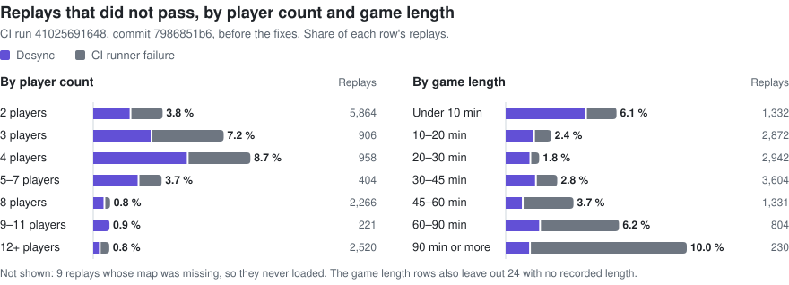

# Retail replay parity

Real games from the FAF replay vault, multiplayer and against the built-in AI or M28AI, are played back on the rebuilt engine and checked bit for bit against the original `ForgedAlliance.exe`. The latest nightly run played 2,139 replays: 2,127 pass (99.44 %), 5 are expected desyncs whose cause isn't this engine, and 7 were new failures of ours, fixed since. 27064121, which failed once those were fixed, is fixed on master too, and no CI run has played that yet. In the largest run, on GitHub Actions, 12,714 of 13,148 replays (96.7 %) match every checksum the live players recorded; counting the fixes made since, 12,783 (97.2 %), worked out rather than measured. Of the 231 replays with a differing checksum, 53 % come from maps and game content the run did not provide, 15 % from live games whose players already disagreed, 3 % fail on retail too, 30 % come from our bugs, all fixed, and none is left unexplained. Over all three of those CI runs, 16,667 of 17,077 replays with a verdict (97.60 %) pass and none of the 315 with a differing checksum is unexplained.

A differing checksum is called a desync here only when it is ours to fix or the live players' own game split. What isn't this engine's shows as an expected desync in the run's report, with its reason.

*Snapshot: 05/11/2026.*

## Current result

### Nightly run 41903353755 (04–05/11/2026)

The latest measured result. The [Replay parity workflow](../.github/workflows/replay-parity.yml) on commit `d3e4f594a`, Linux x64 headless, took the same 5,000 replays of the `nightly` set it plays every night.

| Result | Replays | Meaning |
|---|---|---|
| **Pass** | **2,127** | every recorded checksum matches |
| New failure | 7 | a checksum differs and the replay isn't on the expected list, so it counts as our bug until shown otherwise |
| Expected desync | 5 | a checksum differs, and the cause isn't this engine: listed with its reason in [expected/3835.json](../tools/parity-data/expected/3835.json) |
| Expected error | 1 | 26916675: its map, `na_alps`, isn't on FAF's map server (HTTP 404), so it can't be played |
| Not run | 334 | 306 had no time left in their job, 28 have no reason recorded |
| Not scheduled | 1,055 | past the 40 jobs the run holds |
| Unsupported | 1,471 | sim mods or another game version |

So 2,127 of the 2,139 replays played (99.44 %) pass, and 2,132 (99.67 %) counting the expected ones. All 7 new failures were ours, and all have fixes on master, though no CI run has played those fixes yet:

- **26904791, 26953636, 26990495, 26992801, 26995947, 26997855**: broke with `88bcf97ce`, which stopped returning 11-bone pose arrays to the x64 formation block list. `f38d11f7a` undoes it.
- **26910291**: new formations reused a freed formation's address, so stale pointers still matched. This run had the first part of the fix, `8c9f609e5`, but not the part that finishes it, `931c711af`.
- On a Linux build with those two fixes, 156 of 157 replays played clean, these seven among them.

**27064121** (survival run v8) passed this run only because of `88bcf97ce`, and failed at beat 7,400 once that was undone. Neither version matched retail. The x64 block list now follows retail's log of that memory class, as [SimBlockLane.h](../src/moho/sim/SimBlockLane.h) explains: pose arrays take blocks and don't return them, an id pool's words and the visible decal storage take blocks too, and expired decals go highest id first. On Linux x64 that plays 156 of 157 replays clean, 27064121 and the six above among them, and 26910291; the one left, 26990495, is below. The result of every other replay in the set is unchanged. The keyframe restarts on 26992801, 27064121 and 26953636 match the uninterrupted run. Highest id first is an approximation of retail's address order, and no CI run has played it yet.

**26990495** (scmp_015) now mismatches at beat 5,200, and that matches retail: it gives our exact hash there, both live players recorded another, and the sync logs of retail and ours are the same from beat 5,134 to 5,204. The build this run played passed it only because it differs from retail. It is on the expected list.

Replays not run in the night before, run 41709411384 (312 of them), were played on Linux on `019418f30`: 290 clean, 12 mismatched only at beats where the players' own checksums split and ours has at least as many players behind it, 26881061 where retail gives our hashes and both live players recorded another, which is now on the expected list, and 9 hit the time limit because the replay ends paused with no resume. Of the 312, 20 end that way; retail stops at the pause on 26883035.

### CI run 41025691648 (30–31/10/2026)

The [Replay parity workflow](../.github/workflows/replay-parity.yml) on commit `7986851b6`, x64 headless, played 13,148 of 14,838 listed replays before the run was cancelled. A replay passes when every checksum the live players recorded matches.

| Result | Replays | Share of played | Cause |
|---|---|---|---|
| **Pass** | **12,714** | **96.70 %** | every recorded checksum matches |
| Checksum mismatch | 231 | 1.76 % | split below |
| Timeout | 121 | 0.92 % | the job's time ran out before the replay ended; no mismatch in any of them |
| Crash | 73 | 0.56 % | the runner's map extraction (`Map loader ... aborted`, scmp_001/002/004 and one dual_gap), fixed in the runner after the run (`94c6ab12f`) |
| Error | 9 | 0.07 % | the map is not on FAF's map server (HTTP 404): generated maps and `na_alps` |

The 231 mismatches by cause, as of master `ba75dddf6` (03/11/2026):

| Cause | Replays | Share of mismatches | Share of played | Engine bug? |
|---|---|---|---|---|
| Maps and content the run did not provide or a replay cannot repeat | 122 | 52.8 % | 0.93 % | no |
| Live game split: the players' own checksums already disagreed | 34 | 14.7 % | 0.26 % | no (all 34 played on retail, see below) |
| Retail fails there too | 6 | 2.6 % | 0.05 % | no |
| Our bugs, fixed | 69 | 29.9 % | 0.52 % | yes, fixed |
| Not explained yet | 0 | 0 % | 0 % | none left |

With the 69 fixed, 12,783 of 13,148 (97.22 %) would pass on master. This is worked out from the fixes: no full CI run has played the new build yet. They were tested on x64, on single replays and the core and extended sets. Not counting the runner's own failures and the content gaps (timeouts, crashes, errors, 122 content desyncs), none of the 12,823 replays left was known to fail because of the engine on 03/11/2026; what is open now is under the nightly run above.

- **Maps and content (122).** 102 on survival maps whose scripts import the campaign's `X1CA_00N_strings.lua`, which this run's game data lacked (survival_horde*, survival_dday_horde, survival_shillingstone, survival_stranded, survival_the_goats_last_hope, xxx_survival, sh1r3_mycelium2_survival); 31 of them were replayed with the retail `X1CA_001`..`006` maps added and all 31 pass. 19 on maps that ship their own unit blueprints (survival_cybran_wrath, blackstar, little_pass_revised, adaptive_esais_vengeance): the game loads those only when `Game.prefs` names the map, which the runner did not write yet; the beat-0 hash `c3179fbe` is "no map blueprints loaded" on any map. 7 of them were replayed with a `Game.prefs` naming the map and all 7 pass. The other 83 of these 121 have not been played with their content yet. The runner has provided both since 31/10/2026 (`9424ce27a`, `24cdb0977`), after this run's commit: in the two later runs, all 20 replays on these maps pass. One (26831761, survival_the_goats_revenge) reads the real-time clock inside the sim: `Utilities/PerformanceMonitor.lua` calls `GetSystemTimeSecondsOnlyForProfileUse` every 40 game seconds and, when the game runs slowly, changes spawn counts, health and damage. A replay matches only if it repeats the live game's changes, and how fast it plays decides that: without a change ours fails at beat 20,300 in 6 of 6 repeats, and three runs that the map measured as slow (efficiency 0.73 to 0.75 in its log) changed tier and failed at 18,650, 19,550 and 20,550. Retail fails at 13,050 for the same reason (its run changed at beat 12,900). In a test copy of the map with the decisions forced to tier 2 at beat 20,100, 3 at 20,500, 1 at 20,900, 2 at 22,900 and 1 at 23,300, found by trying each tier in turn, the whole game plays with 0 mismatches.
- **Live game split (34).** The players recorded different checksums at the same beat and ours equals some of them, so the live game itself had desynced there: 32 one-against-one, 26843589 with 3 players on our hash and 1 on another, and 26844459 with 4 on our hash and 6 on another. All 34 were played on retail, and 33 give our hashes: 31 the exact hash CI's run of ours gave, at the same beat, 26884599 the same 67 mismatch lines from beat 50, and 26843589, once both have the campaign maps it needs, the same 48 lines. The one left, 26844459, differs because of one defect in retail's replay path, `CClientBase::UpdateState` (0x0053C550): after a claim of a command source the binary leaves its gate closed, so a replay loses the commands of any stretch that starts with no valid source, which means its opening messages and the commands right after a player leaves. Ours opens the gate on purpose (`CClientBase.cpp`, `[DELIBERATE-FIX]`). In 26844459 two players left at beats 11,859 and 11,895; from beat 11,900 to the end retail matches no player, the same way in 3 of 3 runs, and ours equals the group of 4 at all 196 split beats. With our gate fix turned off, a test build gives retail's hashes at all 6 beats compared (11,900 to 12,150).
- **Retail fails there too (6).** Five give retail's exact hash. 26974352 mismatches at one checksum, beat 39100, on both retail and ours, with different hashes, and both then match at every later checksum: the sync logs first differ in the order of one `Destroy`, and the state heals.
- **Our bugs, fixed (69).** 24 by the cheat commands (`649cb57b5`: `CreateUnit` kept retail's layer override, `BlingBling` adds to the army's resources; `3e2299f95`: height-rect clamp), 5 by formation address reuse (`9f33f6980`, `9c2bf7c7b`), 4 by a self-destruct order with no units, which in retail still runs the cheat check that feeds the checksum (`7ced1a507`), 5 by a ferry transport whose route anchor is NaN, which retail's unordered compare keeps parked (`e1899bc9e`), 4 by a build drone on a wreck, whose failed `GetRebuildBonus` call makes retail reclaim the wreck (`39ef86768`), 1 by the Lua C-call limit, whose overflow error left the depth count one high, so a nuke's chain of death explosions nested deeper than retail's (`678ec0a5e`), 1 by assist pods given a repair task with no target when the host reclaims a non-unit (`451934299`), 2 by factory orders no longer drawing from the sim's random stream (`ba1058e02`; one of the two not confirmed), 7 by the order in which x64 reuses freed memory (`e986fd701`: 26846675, 26916583, 26949920, 26841630, 26901494, 26906026 and 26867306; all 7 play past their CI beat, 4 of them to the end of the game), 2 by the order of a distance sum (`2dcde350d`: 26902525 and 26907417, both clean to the end of the game; 26907417 still fails at CI's beat with only the memory fix), 2 by a tactical launcher ordered to fire at a NaN position (`a7b7e1921`: 26935320 and 26887317, both clean to the end of the game), 1 by a replay's opening beat-0 reports, which retail's closed gate never compares (`ba75dddf6`: 26880558, where one player's hash differs only at beat 0; a debugger shows retail's first compare at beat 50, and ours now plays the whole game with 0 mismatches as retail does), and 11 that pass on master with the fixing commit not identified.
- **Not explained (0).** The last one, 26831761, is the map clock case under maps and content.

The same run by player count and game length, before the fixes:

<picture>
  <source media="(prefers-color-scheme: dark)" srcset="images/parity-breakdown-dark.svg">
  
</picture>

48 of the 50 mismatches at 4 players are on survival_horde_ee, survival_horde_ee_ba, survival_cybran_wrath and survival_horde, maps named under maps and content above. In games of 90 minutes or more, 15 of the 20 runner failures are timeouts, where the job's time ran out. `tools/parity-data/chart.py` draws these charts from the run's report.

### All three CI runs

Two more runs of the same workflow added replays the first did not reach: 41204776548 (31/10/2026, commit `75d34ffad`) with 2,536 passes and 61 mismatches, and 41281894679 (01/11/2026, commit `662a68129`) with 1,417 passes and 23 mismatches, on top of the first run's rows. Taking each replay once, with its best verdict from any run:

| Result | Replays | Share of those with a verdict |
|---|---|---|
| **Pass** | **16,667** | **97.60 %** |
| Checksum mismatch | 315 | 1.84 % |
| Timeout only | 74 | 0.43 % |
| Crash only | 21 | 0.12 % |

No replay has both a pass and a mismatch. Of the 43,091 listed, the other 26,014 have no verdict: 13,079 are unsupported (sim mods or another game version) and 12,935 were never played, because their job was cancelled or ran out of time, apart from a few whose map could not be fetched.

The 315 mismatches by cause, as of master `019418f30` (04/11/2026):

| Cause | Replays | Share of mismatches | Share with a verdict | Engine bug? |
|---|---|---|---|---|
| Pass on a later build | 143 | 45.4 % | 0.84 % | fixed, see below |
| Maps and content | 122 | 38.7 % | 0.71 % | no |
| Live game split | 44 | 14.0 % | 0.26 % | no |
| Retail fails there too | 6 | 1.9 % | 0.04 % | no |
| Not explained yet | 0 | 0 % | 0 % | none left |

Counting the 143, 16,810 of 17,077 (98.44 %) would pass. This is worked out: no full CI run has played current master.

- **The first run's 231** are split in the section above. The other 84 were each played to the end, x64 headless, 74 on a build of `ba75dddf6` and 10 on `019418f30`.
- **Pass on a later build (74 of the 84).** One has a known cause: 26939667 mismatched from beat 23,300 until `019418f30`, where a factory treats a NaN income as the binary does, and now plays all 61,281 beats with no mismatch. For the other 73 the fixing commit is not identified: they failed on the older builds and pass now.
- **Live game split (10 of the 84).** 26966538, 27001813, 26957395, 26893319, 26882046, 26928693, 26926930, 26925023, 26941574 and 26945410. Every mismatch is at a beat where the players recorded different checksums, and ours equals one player's. No build can match both sides of a recording, so most of these were not played on retail; 27001813 and 26957395 were and give the same result as ours. Two limits: in 26926930 the replay ends at the game-over packet on the side ours follows, so 21 split beats after it are not compared, and in 26925023 the last checksum, beat 32,150, comes only from the player on the other side.

### Local run, 28–29/10/2026

- **x64 `headless_x64.exe`, master `4cebee11e`** (parity build `c6e3d7ad31`), `/simworkers 8`, game version 3835, played by the [parity runner](../tools/replay-parity/README.md) in headless mode (the simulation alone, see Method) overnight on 28–29/10/2026, 21:30 to 06:13: 449 vault replays on 168 maps, 1–12 players (49 single-player games), 3 to 108 minutes, 26 with M28AI (v292 to v296); 232 hours of game in total. The set contains all 323 replays of the 27/10/2026 run and 126 more.
- **448 match every checksum** to the end of the game, each in a single run. In 11 of them one or two clients desynced in the live game, and the rebuilt engine matches every other client (see below).
- **1 does not match**: 27051951 (Proxima m) at beat 50, the first checksum the replay holds, as on 27/10/2026. A mismatch before the game has really started points at the map rather than at gameplay; it is not investigated yet.
- **Seven of the eight replays open on 27/10/2026 are fixed** and play to the end with every checksum matching:
  - 26906717 and 27053262: a busy builder hands a sacrifice to the unit it builds (`36fe757b7`).
  - 26870309, 26892799, 26961234 and 27028303: diagonal projectile misses on the height field, and the occupancy grid's last cell row (`7f64e6c06`).
  - 26954789: NaN converts to the integer indefinite, as in the binary (`79b0ebc7a`).
- **Earlier results**: 315 of 323 on 27/10/2026 (x64 clang-cl, `cd595ae0d` plus uncommitted changes, played in the game; 27049782 fixed on the rerun by `74219d154`); all 75 replays of the 24/10/2026 set on master `22a00a44` (MSVC, D3D12), and 76 of 76 on 20/10/2026.

## Method

1. **Screening.** The rebuilt engine plays the replay back and compares its sim checksum with the checksums the live players' clients recorded into the replay every 50 beats. [`tools/replay-parity`](../tools/replay-parity/README.md) does this unattended: it picks the replays, plays several at once, and records a verdict per replay and build. By default it plays them in `headless_x64.exe`, the simulation alone running flat out; in gui mode it plays them in the game with the window hidden, which also covers the client.
2. **Narrowing.** When a replay diverges, the window is narrowed beat by beat: retail and the rebuilt engine both dump the full sim state on every beat (`sim_ChecksumPeriod` 1) and the dumps are diffed. One differing bit anywhere in the sim state fails the beat.
3. **Regression.** Every fix is re-screened against all replays that already matched before it is committed.

Replays are sampled at random from the vault (ids 26,860,000 to 27,065,000, which still ran game version 3835). A game qualifies when it runs the standard FAF game version, is at least five minutes long by its header, needs no sim mod other than M28AI, and its map can be downloaded (generated maps cannot). Custom maps and the M28AI version a game was recorded with are fetched from the FAF content server.

**M28AI version must match exactly.** A replay that uses M28AI must be played with the M28AI version it was recorded with; the wrong version desyncs within minutes (26883423, recorded with v292 and played with v293, desynced at beat 3400).

## Results

Build `c6e3d7ad31`, every replay played once. "All checksums match" means every checksum the live clients recorded, from start to end. Players counts people; AI armies are not counted. Length is game time, from the replay's command stream.

### Not matching yet

| Replay | Map | Players | Length | Result |
|---|---|---|---|---|
| 27051951 | Proxima m | 1 | 30 min | **Mismatch at beat 50**, the first checksum, as on 27/10/2026; probably the map, not investigated yet |

### Every replay

All 449 replays of the run

| Replay | Map | Players | Length | Result |
|---|---|---|---|---|
| 26860038 | DualGap Adaptive | 12 | 46 min | All checksums match |
| 26860303 | Winter Duel | 2 | 7 min | All checksums match |
| 26860459 | Astro Crater Battles 4x4 rich huge | 8 | 27 min | All checksums match |
| 26861889 | Astro Crater Battles 5x5 rich huge | 10 | 30 min | All checksums match |
| 26861943 | DualGap Adaptive | 12 | 37 min | All checksums match |
| 26862501 | Survival Horde EE | 2 + M28AI v292 | 30 min | All checksums match |
| 26863605 | Adaptive Salt and Pepper | 2 | 13 min | All checksums match |
| 26864418 | DualGap Adaptive | 12 | 43 min | All checksums match |
| 26864824 | Gentleman's Reef | 2 | 48 min | All checksums match |
| 26866653 | Astro mini | 6 | 11 min | All checksums match |
| 26867098 | Astro Crater Battles 4x4 rich huge | 8 | 25 min | All checksums match |
| 26868320 | Adaptive Ndera | 4 | 35 min | All checksums match |
| 26868697 | Serenity Reef 5v5 | 2 | 31 min | All checksums match |
| 26868865 | DualGap Adaptive | 12 | 3 min | All checksums match |
| 26868898 | Skellige | 2 | 43 min | All checksums match |
| 26869955 | Saltrock Colony | 2 | 77 min | All checksums match |
| 26870067 | Fields of Isis | 2 | 91 min | All checksums match |
| 26870309 | Up Hill Battle | 2 | 49 min | All checksums match |
| 26873045 | DualGap Adaptive | 12 | 25 min | All checksums match |
| 26873889 | Adaptive Kusoge | 4 | 19 min | All checksums match |
| 26874037 | Fields of Isis | 2 | 15 min | All checksums match |
| 26874348 | Adaptive Metir | 8 | 33 min | All checksums match |
| 26874626 | DualGap Adaptive | 12 | 18 min | All checksums match the other clients'; HedgeHO desynced in the live game at beat 4,950 |
| 26876279 | Seton's Clutch | 8 | 37 min | All checksums match |
| 26876944 | Astro Crater Battles 4x4 rich huge | 8 | 27 min | All checksums match |
| 26878981 | beach battle | 2 + M28AI v292 | 25 min | All checksums match |
| 26879494 | Survival Experimental Factory | 3 | 16 min | All checksums match |
| 26880252 | Aalhaven | 2 | 26 min | All checksums match |
| 26880521 | Twin Fortress | 3 | 49 min | All checksums match |
| 26880663 | DualGap Adaptive | 12 | 12 min | All checksums match |
| 26881085 | Fields of Isis | 4 | 21 min | All checksums match |
| 26881086 | Adaptive pass lev | 12 | 31 min | All checksums match |
| 26882322 | Four-Leaf Clover | 1 | 108 min | All checksums match |
| 26883059 | Astro Crater Battles 4x4 rich huge | 8 | 36 min | All checksums match |
| 26883341 | Astro Crater Battles 4x4 rich huge | 8 | 35 min | All checksums match |
| 26883423 | DualGap Adaptive | 2 + M28AI v292 | 18 min | All checksums match |
| 26883922 | Hargreven | 2 | 10 min | All checksums match |
| 26885419 | Vya-3 Protectorate | 2 | 18 min | All checksums match |
| 26885749 | DualGap Adaptive | 12 | 54 min | All checksums match |
| 26886062 | Four-Leaf Clover | 2 | 25 min | All checksums match |
| 26886299 | Astro Crater Battles 4x4 rich_v2 | 2 + M28AI v292 | 46 min | All checksums match |
| 26886346 | Concord Lake | 1 | 14 min | All checksums match |
| 26887847 | Winter Duel | 2 | 18 min | All checksums match |
| 26888908 | DualGap Adaptive | 12 | 34 min | All checksums match |
| 26890886 | WARTIME 5vs5 | 1 | 10 min | All checksums match |
| 26891092 | Flooded Strip Mine | 2 | 3 min | All checksums match |
| 26891644 | Regor VI Highlands | 2 | 13 min | All checksums match |
| 26892031 | gap of rohan | 4 | 11 min | All checksums match |
| 26892082 | DualGap Adaptive | 1 | 34 min | All checksums match |
| 26892799 | DualGap Adaptive | 12 | 48 min | All checksums match |
| 26892982 | Seton's Clutch | 4 | 57 min | All checksums match |
| 26893801 | DualGap Adaptive | 12 | 40 min | All checksums match |
| 26894670 | Astro Crater Battles 4x4 rich huge | 8 | 37 min | All checksums match |
| 26895006 | Open Palms | 2 | 12 min | All checksums match |
| 26895125 | Astro Crater Battles 4x4 rich huge | 8 | 23 min | All checksums match |
| 26895595 | sfaasd | 2 | 35 min | All checksums match |
| 26896281 | DualGap Adaptive | 12 | 53 min | All checksums match |
| 26896405 | Astro Crater Battles 4x4 v2 TeamPlay AI | 4 | 37 min | All checksums match |
| 26896900 | Astro Crater Battles 4x4 overmap | 8 | 29 min | All checksums match |
| 26897073 | DualGap Adaptive | 12 | 34 min | All checksums match |
| 26897183 | Hargreven | 2 | 28 min | All checksums match |
| 26897194 | Adaptive Rainy day | 2 | 17 min | All checksums match |
| 26897523 | Tabula rasa v3 | 2 | 24 min | All checksums match |
| 26898067 | Seton's Clutch | 8 | 15 min | All checksums match |
| 26898540 | survival_5thdimension v9 | 2 | 31 min | All checksums match |
| 26898759 | DualGap Adaptive | 12 | 46 min | All checksums match |
| 26899506 | Four-Leaf Clover | 2 | 85 min | All checksums match |
| 26899616 | Arctic Refuge | 1 | 4 min | All checksums match |
| 26899626 | Seton's Clutch | 8 | 3 min | All checksums match |
| 26899645 | DualGap Adaptive | 12 | 31 min | All checksums match |
| 26900179 | Setons Clutch - FAF version | 8 | 51 min | All checksums match |
| 26900602 | Seraphim Glaciers | 1 | 63 min | All checksums match |
| 26901038 | ParadiseBay 5v5 | 3 | 52 min | All checksums match |
| 26901500 | Seton's Clutch | 2 | 23 min | All checksums match |
| 26901551 | Twin Rivers | 2 | 34 min | All checksums match |
| 26902315 | The Dark Heart | 3 | 13 min | All checksums match |
| 26902701 | Esgaroth's Ruins | 2 | 48 min | All checksums match |
| 26903590 | Tesla island | 1 + M28AI v293 | 8 min | All checksums match |
| 26903696 | Seton's Clutch | 2 | 64 min | All checksums match |
| 26904089 | Esgaroth's Ruins | 2 | 19 min | All checksums match |
| 26904639 | Olymp 3 | 2 | 79 min | All checksums match |
| 26904914 | DualGap Adaptive | 1 | 28 min | All checksums match |
| 26904985 | Emerald Crater | 1 | 11 min | All checksums match |
| 26905122 | Cursed Souls | 3 + M28AI v293 | 83 min | All checksums match |
| 26905489 | DualGap Adaptive | 12 | 33 min | All checksums match |
| 26906674 | Shards | 1 | 73 min | All checksums match |
| 26906717 | DualGap Adaptive | 12 | 36 min | All checksums match |
| 26906954 | DualGap Adaptive | 12 | 44 min | All checksums match |
| 26906984 | DualGap Adaptive | 12 | 34 min | All checksums match |
| 26907642 | Endless Survival Defense | 4 | 79 min | All checksums match |
| 26907862 | Astro Crater Battles 4x4 rich huge | 3 | 39 min | All checksums match |
| 26908279 | Skellige | 2 | 59 min | All checksums match |
| 26911139 | Strip Mine | 1 + M28AI v292 | 35 min | All checksums match |
| 26911889 | ambush the enemy | 1 | 12 min | All checksums match |
| 26912041 | Skellige | 2 | 18 min | All checksums match |
| 26912284 | United Kingdom 40km map | 3 + M28AI v293 | 38 min | All checksums match |
| 26912336 | Finn's Revenge | 1 | 10 min | All checksums match |
| 26913931 | Crag Dunes | 2 | 24 min | All checksums match |
| 26914129 | Skellige | 2 | 31 min | All checksums match |
| 26914763 | Seton's Clutch | 8 | 21 min | All checksums match |
| 26915161 | Astro Crater Battles 4x4 rich huge | 8 | 32 min | All checksums match |
| 26915602 | Astro Crater Battles 4x4 rich huge very long | 3 | 70 min | All checksums match |
| 26915859 | Dunes of Arracis | 2 | 50 min | All checksums match |
| 26916474 | Astro Crater Battles 4x4 rich huge | 8 | 21 min | All checksums match |
| 26916677 | DualGap Adaptive | 12 | 10 min | All checksums match |
| 26916866 | Seton's Clutch | 8 | 37 min | All checksums match |
| 26917150 | DualGap Adaptive | 12 | 49 min | All checksums match |
| 26917414 | Drake's Ravine | 4 | 61 min | All checksums match |
| 26917867 | DualGap Adaptive | 12 | 35 min | All checksums match |
| 26918561 | DualGap Adaptive | 12 | 12 min | All checksums match |
| 26919133 | Astro Crater Battles 5vs5 | 2 + M28AI v293 | 54 min | All checksums match |
| 26919698 | Hargreven | 2 | 14 min | All checksums match |
| 26919967 | DualGap Adaptive | 12 | 46 min | All checksums match |
| 26921104 | Astro Crater Battles 4x4 rich huge | 8 | 27 min | All checksums match |
| 26921423 | DualGap Adaptive | 12 | 17 min | All checksums match |
| 26921812 | Daroza's Sanctuary | 2 | 36 min | All checksums match |
| 26922044 | DualGap Adaptive | 12 | 7 min | All checksums match the other clients'; nyTHuK desynced in the live game at beat 4,300 |
| 26922182 | DualGap Adaptive | 12 | 29 min | All checksums match |
| 26922805 | Vya-3 Protectorate | 2 | 17 min | All checksums match |
| 26922846 | Seton 80km | 1 | 17 min | All checksums match |
| 26923279 | Skellige | 2 | 27 min | All checksums match |
| 26923388 | Hargreven | 2 | 45 min | All checksums match |
| 26924463 | Adaptive Rainy day | 2 | 22 min | All checksums match |
| 26924552 | Finn's Revenge | 2 | 7 min | All checksums match |
| 26924580 | pass lev | 12 | 40 min | All checksums match |
| 26924888 | Astro Crater Battles 4x4 rich huge | 8 | 31 min | All checksums match |
| 26925096 | Four-Leaf Clover | 1 | 19 min | All checksums match |
| 26925538 | Adaptive Metir | 4 | 29 min | All checksums match |
| 26925548 | Finn's Revenge | 2 | 7 min | All checksums match |
| 26925645 | Emerald Crater | 1 | 18 min | All checksums match |
| 26926208 | MegaCIty | 1 + M28AI v293 | 46 min | All checksums match |
| 26926345 | Regor VI Highlands | 2 | 15 min | All checksums match |
| 26927336 | Crag Dunes | 2 | 7 min | All checksums match |
| 26927488 | Aalhaven | 1 | 7 min | All checksums match |
| 26928140 | DualGap Adaptive | 12 | 29 min | All checksums match |
| 26928211 | Astro Crater Battles 4x4 rich huge | 8 | 27 min | All checksums match |
| 26928802 | Seton's Clutch | 8 | 39 min | All checksums match |
| 26929261 | Adaptive pass lev | 12 | 67 min | All checksums match |
| 26929320 | gap_of_rohan v4_fixed_pathing | 4 | 12 min | All checksums match |
| 26930121 | Aalhaven | 2 | 57 min | All checksums match |
| 26930300 | DualGap Adoptive | 4 + M28AI v293 | 64 min | All checksums match |
| 26930624 | Open Palms | 2 | 14 min | All checksums match |
| 26930750 | Twin Rivers | 2 | 18 min | All checksums match |
| 26931142 | DualGap Adaptive | 12 | 20 min | All checksums match |
| 26932281 | Desolate Dunes | 2 | 15 min | All checksums match |
| 26932432 | Open Palms | 2 | 23 min | All checksums match |
| 26933064 | DualGap Adaptive | 12 | 42 min | All checksums match |
| 26933269 | DualGap Adaptive | 2 + M28AI v293 | 47 min | All checksums match |
| 26933322 | Regor VI Highlands | 2 | 9 min | All checksums match |
| 26933355 | Astro Crater Reworked 4x4 rich | 8 | 36 min | All checksums match |
| 26933703 | Adaptive Rainy day | 2 | 11 min | All checksums match |
| 26934325 | Winter Duel | 2 | 7 min | All checksums match |
| 26934456 | Astro Crater Battles 4x4 overmap | 8 | 34 min | All checksums match |
| 26934533 | Shards | 2 | 35 min | All checksums match |
| 26935037 | Adaptive Monument Valley | 8 | 23 min | All checksums match the other clients'; Rikudo7 desynced in the live game at beat 6,850 |
| 26935255 | IsisFields3v3 | 6 | 46 min | All checksums match |
| 26935404 | Moonlight | 2 | 35 min | All checksums match |
| 26935782 | Blasted Rock | 2 | 60 min | All checksums match |
| 26935800 | DualGap Adaptive | 12 | 41 min | All checksums match |
| 26936179 | canis 4v4 spezial edition | 4 | 66 min | All checksums match |
| 26936566 | Seton's Clutch | 8 | 32 min | All checksums match |
| 26936880 | Polar Depression | 2 | 23 min | All checksums match |
| 26937940 | DualGap Adaptive | 12 | 35 min | All checksums match |
| 26938254 | Astro Crater Reworked 4x4 rich | 2 | 105 min | All checksums match |
| 26938555 | astro crater survival no mods | 1 | 45 min | All checksums match |
| 26938626 | Adaptive Dark Liver | 2 | 41 min | All checksums match |
| 26939703 | Polar Depression | 4 | 21 min | All checksums match |
| 26939767 | Astro Crater Reworked 4x4 rich | 8 | 27 min | All checksums match |
| 26939800 | Concord Lake | 4 | 36 min | All checksums match |
| 26940130 | Vale of Isis | 2 | 50 min | All checksums match |
| 26940728 | Astro Crater Battles 4x4 overmap | 8 | 58 min | All checksums match |
| 26941232 | Astro Crater Battles 4x4 overmap | 7 | 42 min | All checksums match |
| 26942293 | DualGap Adaptive | 12 | 30 min | All checksums match |
| 26942607 | Astro Crater Battles 4x4 rich huge | 8 | 13 min | All checksums match |
| 26942767 | DualGap Adaptive | 1 | 5 min | All checksums match |
| 26942862 | DualGap Adaptive | 12 | 24 min | All checksums match |
| 26942923 | Finn's Revenge | 2 | 6 min | All checksums match |
| 26943656 | Mechanoclastic Rush | 6 + M28AI v294 | 15 min | All checksums match |
| 26943902 | Astro Crater Battles | 6 | 22 min | All checksums match |
| 26944503 | Vya-3 Protectorate | 2 | 14 min | All checksums match |
| 26945390 | Astro Crater Battles 5x5 rich huge | 10 | 32 min | All checksums match |
| 26945918 | Adaptive passV16 lev | 12 | 6 min | All checksums match |
| 26946725 | DualGap Adaptive | 12 | 14 min | All checksums match the other clients'; Paulosan desynced in the live game at beat 6,700 |
| 26948234 | Arcane | 2 + M28AI v294 | 38 min | All checksums match |
| 26948638 | Adaptive Omorfia Trance | 2 + M28AI v294 | 30 min | All checksums match |
| 26949427 | Open Palms | 2 | 32 min | All checksums match |
| 26949465 | Forbidden Pass - FAF version | 2 | 88 min | All checksums match |
| 26949621 | DualGap Adaptive | 12 | 10 min | All checksums match |
| 26949684 | Survival Horde | 1 | 26 min | All checksums match |
| 26950049 | DualGap Adaptive | 12 | 36 min | All checksums match |
| 26950767 | Miaziknog | 3 | 37 min | All checksums match |
| 26950869 | The Taylors Pass | 2 | 36 min | All checksums match |
| 26951613 | Vya-3 Protectorate | 2 | 14 min | All checksums match |
| 26952345 | Astro Crater Battles 4x4 overmap | 8 | 29 min | All checksums match |
| 26952549 | Frithen | 2 | 15 min | All checksums match |
| 26952597 | Twin Rivers | 4 | 37 min | All checksums match |
| 26953273 | Seton's Clutch | 8 | 30 min | All checksums match |
| 26954643 | Astro Crater Battles 3x3 rich | 3 | 51 min | All checksums match |
| 26954789 | DualGap Adaptive | 12 | 51 min | All checksums match |
| 26954937 | DualGap Adaptive | 12 | 38 min | All checksums match |
| 26954959 | DualGap Adaptive | 12 | 37 min | All checksums match |
| 26955524 | Regor VI Highlands | 2 | 28 min | All checksums match |
| 26955642 | Seton's Clutch | 1 | 23 min | All checksums match |
| 26956341 | setonscrotchsurvivalv2 | 2 | 62 min | All checksums match |
| 26956508 | DualGap Adaptive | 2 | 25 min | All checksums match |
| 26956892 | Vale of Isis | 2 | 12 min | All checksums match |
| 26957207 | DualGap Adaptive | 12 | 35 min | All checksums match |
| 26958035 | WARZONE-WALLS | 2 | 64 min | All checksums match |
| 26958040 | Astro Crater Reworked 4x4 rich | 2 | 23 min | All checksums match |
| 26958217 | Twin Rivers | 1 | 21 min | All checksums match |
| 26958235 | Desolate Dunes | 2 | 10 min | All checksums match |
| 26958259 | Astro mini 4v4 | 8 | 8 min | All checksums match |
| 26959374 | Adaptive pass lev | 12 | 32 min | All checksums match |
| 26960230 | Finn's Revenge | 2 | 28 min | All checksums match |
| 26960309 | DualGap Adaptive | 12 | 42 min | All checksums match |
| 26960347 | Ambush Pass | 2 | 9 min | All checksums match |
| 26960349 | Hargreven | 2 | 15 min | All checksums match |
| 26960631 | DualGap Adaptive | 12 | 36 min | All checksums match |
| 26960640 | DualGap Adaptive | 12 | 22 min | All checksums match |
| 26960684 | Open Palms | 1 | 10 min | All checksums match |
| 26960818 | Daroza's Sanctuary | 2 | 27 min | All checksums match |
| 26961234 | Adaptive Argon | 2 + M28AI v295 | 57 min | All checksums match |
| 26962139 | Seton's Clutch | 8 | 53 min | All checksums match |
| 26963526 | choir and flagellant | 2 | 8 min | All checksums match |
| 26963674 | Vya-3 Protectorate | 2 | 21 min | All checksums match |
| 26963960 | Astro Crater Battles 4x4 rich huge | 8 | 22 min | All checksums match |
| 26964071 | Wave_of_Death_v1.20 | 2 | 29 min | All checksums match |
| 26964485 | Adaptive Bonaire | 8 | 21 min | All checksums match |
| 26964838 | Seton's Clutch | 8 | 62 min | All checksums match |
| 26965068 | DualGap Adaptive | 12 | 33 min | All checksums match |
| 26965172 | Hargreven | 2 | 10 min | All checksums match |
| 26965302 | DualGap Adaptive | 12 | 80 min | All checksums match |
| 26965627 | DualGap Adaptive | 12 | 22 min | All checksums match |
| 26966200 | Astro Crater Battles 4x4 rich huge | 8 | 30 min | All checksums match |
| 26966510 | The Bermuda Locket - FAF version | 2 | 22 min | All checksums match |
| 26967137 | Vya-3 Protectorate | 3 | 33 min | All checksums match |
| 26967253 | Adaptive Rainy day | 2 | 16 min | All checksums match |
| 26967600 | Astro Crater Battles 4x4 rich huge very long | 4 + M28AI v295 | 52 min | All checksums match |
| 26968022 | Adaptive Pass Reborn | 3 | 63 min | All checksums match |
| 26968042 | High Noon | 2 | 34 min | All checksums match |
| 26968188 | Desolate Dunes | 2 | 44 min | All checksums match |
| 26968288 | Desolate Dunes | 2 | 16 min | All checksums match |
| 26969742 | Astro Crater Battles 4x4 overmap | 8 | 38 min | All checksums match |
| 26969812 | choir and flagellant | 2 | 45 min | All checksums match |
| 26970386 | DualGap Adaptive | 12 | 35 min | All checksums match |
| 26970939 | The Bermuda Locket - FAF version | 2 | 43 min | All checksums match |
| 26972233 | Aalhaven | 2 | 9 min | All checksums match |
| 26972255 | Astro Crater Battles 4x4 rich huge | 8 | 24 min | All checksums match |
| 26972287 | Adaptive Rainy day | 2 | 27 min | All checksums match |
| 26973109 | DualGap Adaptive | 12 | 32 min | All checksums match |
| 26973213 | Coastal Siege | 3 | 4 min | All checksums match |
| 26973426 | Hargreven | 2 | 5 min | All checksums match |
| 26973725 | DualGap Adoptive | 12 | 43 min | All checksums match |
| 26973812 | Gape of Rohan Rebuild | 1 | 43 min | All checksums match |
| 26974123 | serenity desert small - FAF version | 2 | 14 min | All checksums match |
| 26974389 | DualGap Adaptive | 12 | 21 min | All checksums match |
| 26974452 | Burial Mounds | 3 | 26 min | All checksums match |
| 26975290 | Astro 7923542 | 4 + M28AI v295 | 28 min | All checksums match |
| 26975604 | Fields of Isis | 4 | 44 min | All checksums match |
| 26975644 | Deadlock | 2 | 12 min | All checksums match |
| 26975678 | Fields of Isis | 2 | 40 min | All checksums match |
| 26975853 | Seton's Clutch | 1 | 7 min | All checksums match |
| 26976141 | Adaptive Adrastea | 2 | 22 min | All checksums match |
| 26976383 | Adaptive pass lev | 12 | 29 min | All checksums match |
| 26976406 | Adaptive Rainy day | 2 | 26 min | All checksums match |
| 26977249 | Boreal Nexus | 1 + M28AI v295 | 5 min | All checksums match |
| 26977328 | Sludge | 3 | 18 min | All checksums match |
| 26977448 | The Bermuda Locket | 2 | 88 min | All checksums match |
| 26977584 | Astro Crater Battles 4x4 overmap | 8 | 24 min | All checksums match |
| 26977680 | Adaptive pursuit | 4 | 60 min | All checksums match |
| 26978343 | DualGap Adaptive | 12 | 55 min | All checksums match |
| 26978413 | Gentleman's Reef | 2 | 16 min | All checksums match |
| 26978518 | Gentleman's Reef | 2 | 34 min | All checksums match |
| 26978611 | DualGap Adaptive | 12 | 39 min | All checksums match |
| 26979016 | Setons Clutch - FAF version | 8 | 6 min | All checksums match |
| 26979408 | Adaptive Monument Valley | 8 | 20 min | All checksums match |
| 26980757 | DualGap Adaptive | 12 | 30 min | All checksums match |
| 26982203 | SLi-Fox - European Theater V1 | 3 | 91 min | All checksums match |
| 26982238 | Astro Crater Reworked 4x4 rich | 8 | 8 min | All checksums match |
| 26982330 | Astro Crater Battles 4x4 rich huge | 8 | 35 min | All checksums match |
| 26982657 | DualGap Adaptive | 12 | 37 min | All checksums match |
| 26982834 | Crimson Feud | 2 | 6 min | All checksums match |
| 26983046 | The Drunken Beetles Dance - FAF Version | 2 | 87 min | All checksums match |
| 26983648 | Crimson Feud | 2 | 9 min | All checksums match |
| 26984371 | Seton's Clutch | 2 | 95 min | All checksums match |
| 26985106 | Astro Crater Reworked 4x4 rich | 8 | 25 min | All checksums match |
| 26985138 | Alpha 7 Quarantine | 1 | 31 min | All checksums match |
| 26988102 | Astro Crater Reworked 4x4 rich | 8 | 35 min | All checksums match the other clients'; Auhram desynced in the live game at beat 8,950 |
| 26989179 | Desert Duel | 2 | 33 min | All checksums match |
| 26989770 | High Noon | 1 | 33 min | All checksums match |
| 26989982 | Seton's Clutch | 8 | 14 min | All checksums match |
| 26991386 | Loki - FAF version | 2 | 9 min | All checksums match |
| 26991396 | DualGap Adaptive | 12 | 18 min | All checksums match the other clients'; Brosko95 desynced in the live game at beat 9,850 |
| 26992164 | Seton's Clutch | 8 | 57 min | All checksums match |
| 26992238 | Astro Crater Battles 4x4 rich huge | 8 | 33 min | All checksums match the other clients'; Tofiacz and CloseUpFisting desynced in the live game at beat 14,500 |
| 26992934 | Lena river | 8 | 47 min | All checksums match |
| 26993154 | Fudge | 2 | 54 min | All checksums match |
| 26994566 | DualGap Adaptive | 12 | 37 min | All checksums match |
| 26994861 | DualGap Adaptive | 12 | 35 min | All checksums match |
| 26995039 | Astro Crater Battles 4x4 v2-2 TeamPlay AI | 8 | 47 min | All checksums match |
| 26995326 | DualGap Adaptive | 12 | 42 min | All checksums match |
| 26997072 | Astro Crater Rise Reworked 5x5 | 10 | 23 min | All checksums match |
| 26997113 | Battle of Thermopylae Survival | 2 | 7 min | All checksums match |
| 26997189 | ParadiseBay | 4 | 50 min | All checksums match |
| 26997230 | Adaptive Mars - Mangala Fossa | 3 | 37 min | All checksums match |
| 26997365 | Astro Crater Battles 4x4 rich huge | 8 | 25 min | All checksums match |
| 26998379 | 8 - Badlands_v4 | 2 | 11 min | All checksums match |
| 26998606 | DualGap Adaptive | 12 | 38 min | All checksums match |
| 26999351 | TrinityFails | 2 | 63 min | All checksums match |
| 26999746 | DualGap Adaptive | 12 | 44 min | All checksums match |
| 26999797 | Astro Crater Battles 2v1 | 2 | 42 min | All checksums match |
| 27000265 | OpenWorld Next | 1 | 47 min | All checksums match |
| 27001574 | Saraevgorit | 2 + M28AI v295 | 16 min | All checksums match |
| 27001706 | DualGap Adaptive | 12 | 39 min | All checksums match |
| 27003469 | Astro Crater Battles 4x4 rich huge | 8 | 6 min | All checksums match |
| 27003562 | Fields Of Great Phoenix | 8 | 10 min | All checksums match |
| 27003663 | DualGap Adaptive | 12 | 45 min | All checksums match |
| 27004084 | The Wilderness | 2 | 48 min | All checksums match |
| 27004266 | Astro Crater Battles 4x4 rich huge | 8 | 37 min | All checksums match |
| 27005888 | Loki - FAF version | 2 | 15 min | All checksums match |
| 27006065 | Desert Joust | 2 | 13 min | All checksums match |
| 27006249 | Gates of Anubis | 2 | 13 min | All checksums match |
| 27006809 | DualGap Adaptive | 12 | 19 min | All checksums match |
| 27007344 | Astro Crater Rise Reworked 5x5 | 10 | 30 min | All checksums match |
| 27007566 | Astro Crater Battles 4x4 rich huge | 8 | 40 min | All checksums match |
| 27009529 | DualGap Adaptive | 12 | 39 min | All checksums match |
| 27009771 | DualGap Adaptive | 12 | 44 min | All checksums match |
| 27009953 | 2V2 Sand Box | 2 | 39 min | All checksums match |
| 27010232 | Crimson Feud | 2 + M28AI v295 | 27 min | All checksums match |
| 27010745 | Adaptive Mars - Mangala Fossa | 1 | 46 min | All checksums match |
| 27011241 | DualGap Adaptive | 12 | 12 min | All checksums match |
| 27011499 | Point of Reach v4 | 2 | 28 min | All checksums match |
| 27011701 | Serenity Reef 5v5 | 2 | 28 min | All checksums match |
| 27012107 | Astro mini | 1 | 22 min | All checksums match |
| 27012452 | Seton's Clutch | 8 | 42 min | All checksums match |
| 27012862 | gap_of_rohan v4_fixed_pathing | 1 | 18 min | All checksums match |
| 27013353 | Setons Claw | 3 + M28AI v295 | 50 min | All checksums match |
| 27013791 | Ian's Cross | 1 | 24 min | All checksums match |
| 27014107 | Loki - FAF version | 2 | 31 min | All checksums match |
| 27014316 | Astro Crater Battles | 6 | 6 min | All checksums match |
| 27014438 | DualGap Adaptive | 12 | 11 min | All checksums match the other clients'; Masterprofit desynced in the live game at beat 6,550 |
| 27014439 | Setons Clutch - FAF version | 1 | 10 min | All checksums match |
| 27014512 | DualGap Adaptive | 12 | 31 min | All checksums match |
| 27014542 | Astro Crater Battles 4x4 rich huge | 8 | 32 min | All checksums match |
| 27014751 | Seton's Clutch | 1 | 14 min | All checksums match |
| 27015643 | Liberiam Battles | 4 | 77 min | All checksums match |
| 27015854 | Gates of Anubis | 2 | 30 min | All checksums match |
| 27016140 | DualGap Adaptive | 12 | 33 min | All checksums match the other clients'; Gibsaw desynced in the live game at beat 7,750 |
| 27016319 | Seton's Clutch | 2 | 17 min | All checksums match |
| 27016327 | Desolate Dunes | 2 | 28 min | All checksums match |
| 27016446 | Aalhaven | 2 | 20 min | All checksums match |
| 27018116 | Battle of Thermopylae Survival 5vX | 5 + M28AI v295 | 21 min | All checksums match |
| 27018161 | Four-Corners | 3 | 45 min | All checksums match |
| 27018213 | Williamson's Bridge | 2 + M28AI v295 | 24 min | All checksums match |
| 27018278 | DualGap Adaptive | 12 | 35 min | All checksums match |
| 27018343 | The Ganges Chasma | 2 | 18 min | All checksums match |
| 27019199 | Astro Crater Battles 4x4 overmap | 8 | 26 min | All checksums match |
| 27019405 | Flooded Strip Mine | 2 | 26 min | All checksums match |
| 27019538 | astro crater survival no mods | 2 | 33 min | All checksums match |
| 27019553 | Survival Horde EE | 3 | 7 min | All checksums match |
| 27019599 | DualGap Adaptive | 12 | 35 min | All checksums match |
| 27019665 | Astro Crater Battles 4x4 overmap | 8 | 26 min | All checksums match |
| 27021256 | Astro Crater Battles 4x4 rich huge | 8 | 20 min | All checksums match the other clients'; Foolish_Mortal desynced in the live game at beat 1,450 |
| 27021798 | Desolate Dunes | 2 | 25 min | All checksums match |
| 27021832 | DualGap Adaptive | 12 | 43 min | All checksums match |
| 27022297 | DualGap Adaptive | 12 | 42 min | All checksums match |
| 27022348 | Seton's Clutch | 8 | 10 min | All checksums match |
| 27023198 | Desolate Dunes | 2 | 37 min | All checksums match |
| 27023644 | DualGap Adaptive | 12 | 36 min | All checksums match |
| 27025203 | Skellige | 2 | 57 min | All checksums match |
| 27025504 | Astro Crater Battles 4x4 rich huge | 8 | 32 min | All checksums match |
| 27025965 | Seton's Clutch | 1 | 9 min | All checksums match |
| 27026461 | Firelight | 2 | 41 min | All checksums match |
| 27027645 | DualGap Adaptive | 12 | 14 min | All checksums match |
| 27027788 | Williamson's Bridge | 2 | 5 min | All checksums match |
| 27028303 | Distortion | 1 + M28AI v295 | 21 min | All checksums match |
| 27028851 | Boobs | 12 | 24 min | All checksums match |
| 27028960 | DualGap Adaptive | 12 | 30 min | All checksums match |
| 27029296 | Asteria | 2 | 24 min | All checksums match |
| 27029855 | DualGap Adaptive | 12 | 40 min | All checksums match |
| 27030180 | Loki - FAF version | 2 | 54 min | All checksums match |
| 27030463 | DualGap Adaptive | 12 | 32 min | All checksums match |
| 27030616 | Astro Crater Battles 4x4 rich huge | 8 | 31 min | All checksums match |
| 27030725 | Desolate Dunes | 2 | 73 min | All checksums match |
| 27032464 | Astro Crater Battles 4x4 rich huge | 8 | 19 min | All checksums match |
| 27032544 | The Ditch - FAF version | 2 | 30 min | All checksums match |
| 27032784 | Stairs to Heaven | 1 | 14 min | All checksums match |
| 27033132 | Astro Crater Battles 4x4 rich huge | 8 | 8 min | All checksums match |
| 27033145 | Seton's Clutch | 1 | 6 min | All checksums match |
| 27033400 | rich2v2v2v2 | 4 | 35 min | All checksums match |
| 27034426 | Wonder open 5v5 v3b | 2 | 37 min | All checksums match |
| 27034501 | Adaptive Sand Box | 1 | 21 min | All checksums match |
| 27034626 | Seton's Clutch | 8 | 29 min | All checksums match |
| 27034831 | Astro Crater Battles 3x3 rich | 6 | 35 min | All checksums match |
| 27035419 | Adaptive Rainy day | 2 | 21 min | All checksums match |
| 27036445 | Lego Wars | 1 | 16 min | All checksums match |
| 27036969 | Seton's Clutch 2v2 | 3 | 19 min | All checksums match |
| 27037203 | Ian's Cross | 2 | 15 min | All checksums match |
| 27037222 | DualGap Adaptive | 1 | 31 min | All checksums match |
| 27037528 | The Great Void | 1 | 75 min | All checksums match |
| 27038193 | astrogap | 1 | 39 min | All checksums match |
| 27038207 | serenity desert small - FAF version | 2 | 26 min | All checksums match |
| 27038222 | Map Under Construction | 12 | 11 min | All checksums match |
| 27038384 | Diversity | 4 | 9 min | All checksums match |
| 27038818 | Winter Duel | 1 | 52 min | All checksums match |
| 27039469 | Distortion | 2 | 25 min | All checksums match |
| 27039709 | Astro Crater Battles 4x4 v2 TeamPlay AI | 2 | 27 min | All checksums match |
| 27039808 | DualGap Adaptive | 12 | 30 min | All checksums match |
| 27039978 | Astro Crater Battles 4x4 rich XL | 8 | 3 min | All checksums match |
| 27040206 | Daroza's Sanctuary | 2 | 21 min | All checksums match |
| 27040788 | Lost Wisdom | 1 | 19 min | All checksums match |
| 27042138 | DualGap Adaptive | 1 | 22 min | All checksums match |
| 27042465 | Open Palms | 2 + M28AI v296 | 6 min | All checksums match |
| 27043564 | Sirgis | 2 | 51 min | All checksums match |
| 27043627 | DualGap Adaptive | 12 | 49 min | All checksums match |
| 27044394 | Skellige | 2 | 31 min | All checksums match |
| 27044410 | Comet Catcher | 2 | 10 min | All checksums match |
| 27045174 | Burial Mounds | 4 | 16 min | All checksums match |
| 27045704 | DualGap Adaptive | 12 | 34 min | All checksums match |
| 27045712 | DualGap Adaptive | 12 | 41 min | All checksums match |
| 27047309 | Sweepwing Sanctum | 2 | 7 min | All checksums match |
| 27047847 | Emerald Cliffs | 2 | 13 min | All checksums match |
| 27048226 | DualGap Adaptive | 12 | 62 min | All checksums match |
| 27048760 | Saltrock Colony | 2 | 48 min | All checksums match |
| 27049782 | Europe Fizzys Revenge | 7 | 16 min | All checksums match |
| 27049809 | Astro Crater Battles 4x4 rich huge | 2 | 36 min | All checksums match |
| 27049963 | Seton's Clutch | 8 | 19 min | All checksums match |
| 27051951 | Proxima m | 1 | 30 min | **Mismatch at beat 50**, as on 27/10/2026 |
| 27051974 | Strip Mine | 2 | 51 min | All checksums match |
| 27052007 | Seton's Clutch | 4 | 18 min | All checksums match |
| 27052123 | Drake's Ravine | 2 | 43 min | All checksums match |
| 27052312 | MadSea20x20 | 12 | 38 min | All checksums match |
| 27053080 | Astro Crater Battles 4x4 rich huge | 8 | 34 min | All checksums match |
| 27053262 | Boobs | 10 | 16 min | All checksums match |
| 27053554 | Little Pass X05 | 2 | 9 min | All checksums match |
| 27054166 | Loki - FAF version | 2 | 9 min | All checksums match |
| 27054434 | Astro Crater Battles 4x4 rich huge | 8 | 26 min | All checksums match |
| 27056090 | Astro Crater Battles 4x4 rich huge | 8 | 36 min | All checksums match |
| 27056144 | Point of Reach v4 | 2 | 26 min | All checksums match |
| 27056984 | Seton's Clutch | 2 | 37 min | All checksums match |
| 27057500 | DualGap Adaptive | 12 | 41 min | All checksums match |
| 27057685 | Seton's Clutch | 8 | 29 min | All checksums match |
| 27058515 | Seton's Clutch | 8 | 34 min | All checksums match |
| 27058833 | DualGap Adaptive | 12 | 34 min | All checksums match |
| 27060603 | Astro Crater Battles 4x4 overmap | 8 | 12 min | All checksums match |
| 27062069 | DualGap Adaptive | 12 | 27 min | All checksums match the other clients'; wetlettuce desynced in the live game at beat 3,700 |
| 27062933 | Four-Leaf Clover | 4 | 13 min | All checksums match |
| 27062952 | Assupian | 2 | 29 min | All checksums match |
| 27064011 | DualGap Adaptive | 12 | 42 min | All checksums match |

**A live-game desync is not a playback mismatch.** Every client records its own checksum into the replay. In 26946725 nine clients recorded the same checksum at beat 6,700 and one (Paulosan) recorded another, then the same as everyone again from beat 6,750; the rebuilt engine's checksum is the nine clients' one, at that beat and every later one. The parity runner counts such a beat as the live game's desync, not ours (`tools/replay-parity/README.md`, Watch).

**The final-beat difference is deliberate.** When a player leaves, retail drops the commands that arrive after the leave within the same batch; the rebuilt engine keeps them (`CClientBase::UpdateState`, marked `[DELIBERATE-FIX]`). In a replay this only shows on the last beat, where the remaining players' command sources end.

## Live multiplayer: retail, x86 and x64 in one game

A replay checks the rebuilt engine against checksums the players recorded. A live game checks it against the original engine running next to it: every client computes each beat itself and the clients exchange checksums, so any difference between any two of them is a desync.

| Test | Clients | Result |
|---|---|---|
| `tools/scenarios/3p-retail-control-ai.yaml` | three retail `ForgedAlliance.exe` | 29 min of game time, no desync |
| `tools/scenarios/3p-original-x86-x64-ai.yaml` | retail, rebuilt x86, rebuilt x64 | 21 min of game time, no desync |

- **The game**: a three-way free-for-all on a copy of Seton's Clutch whose script hands every army to FAF's built-in rush AI before the armies are created. Each client runs that AI in its own sim, so all three make the same decisions from the same random stream: expansion, factories, armies of several hundred units, fighting.
- **The check**: each client logs a fingerprint of every army once a minute (units, factories, engineers, stored mass and energy). In the retail, x86 and x64 game all 21 fingerprints are identical on all three clients.
- **The control run** (retail on all three seats) comes first. It shows that the AI-driven game is itself lockstep-safe, so a desync in the mixed run could only come from the rebuilt engines.

## Where divergences came from

- **The 2007 floating-point environment.** The sim keeps some intermediate results in x87 registers at 24-bit precision, where SSE rounds every step: box-vs-box separating-axis radii, vector lengths, the Gaussian's logarithm. These are reproduced with x87 helpers in `src/legacy/math/X87Math*`.
- **Call order in the random-number stream.** An extra or missing call to a function that draws from the sim's random stream shifts every later draw.
- **Order validation.** Checks that accepted orders retail refuses, for example a move order for a unit riding in an ordinary transport.
- **Float-to-integer conversions.** Places that truncate where retail's `fistp` rounds to nearest, such as a unit's footprint cell.
- **Missing state updates.** For example a carrier that never removed a launched unit from its carried set.
- **Dirty-list order.** The beat checksum hashes the sim's list of entities that changed this beat, in order. On an alliance change retail moves every entry the army owns to the end of that list, its recon blips included; ours moved only its units, so the order alone failed the beat (27049782).
- **Who receives a sacrifice.** When the target is building, retail hands the sacrifice to the unit on its pad; ours gave it to the builder, so engineers sacrificed into a full-health factory (26906717, 27053262).
- **NaN conversions.** A tactical missile that hits an air unit computes a NaN glide time. Retail converts NaN to the integer indefinite (0x80000000), so `WaitTicks` ends the thread and the projectile's lifetime is effectively unbounded; ours gave 0 and the next tick, and steered the missile to the ground (26954789).
- **Edge cases on the height field.** A line running exactly along a cell's diagonal divides by zero; retail accepts the crossing only on an ordered comparison, so the NaN end point is a miss, where ours reported a hit far past the segment and destroyed debris early (26870309, 26892799). And a footprint reaching the occupancy grid's last row or column is occupied in retail; ours accepted 1x1 structures there, so M28AI picked different build sites (26961234, 27028303).
- **Engine functions the AI scripts call.** The Lua AI is not part of the checksum, but the orders it issues are. A wrong return value from `CPlatoon:FormPlatoon` raised a Lua error in our build only, the AI stopped issuing orders retail's AI issued, and the games diverged a few hundred beats later.
- **Formation orders.** A patrol given to a group in formation must stay tied to that formation. Ours never passed the formation to the patrol task, so each unit's patrol leg ended on its own arrival check instead of the formation's.
- **Pathfinder edge costs.** The hierarchical pathfinder buckets each edge cost as `ceil(ln(cost / distance) * 6)`. Retail takes the logarithm with the x87 `fyl2x` instruction and rounds only the product to float; ours rounded the logarithm first. Where the product sits at a whole number the bucket moved by one and a unit took a different route; seen only in long AI games, which send many units across the map.
- **Cheat commands.** Games with cheats on create units and add resources through sim callbacks. Ours cleared the layer override retail's `CreateUnit` keeps, and `BlingBling` filled the stored amount instead of the army's resources (24 replays of the CI run).
- **Checks that feed the checksum.** `CheatsEnabled()` hashes its flag into the beat checksum. Retail tests it for a self-destruct order even when no unit was selected; ours returned first, so the beat had one byte less in its hash (26863712 and three more).
- **Reused addresses.** Units keep a raw formation pointer, and `IsSameFormationLayerWith` compares pointers, so a stale pointer can equal a new formation at a reused address. In the binary, formations, projectiles and 11-bone pose arrays come from one 896-byte allocator class, so each takes blocks the others freed. x86 runs the recovered allocator; x64 gives those three objects one last-freed-first list on the sim thread. With only formations in that class, x86 fails 26916583 at beat 4,900 with x64's old hash; adding projectiles fixes that replay, and adding pose arrays fixes 26901494 and 26906026. The allocator's cache trims and the class's other objects did not matter in the replays tried, which does not prove they never do.
- **The order of a float sum.** Float addition is not associative. `FindClosestUnit` adds `(dy*dy + dz*dz) + dx*dx`; ours added `dx*dx + dy*dy + dz*dz`. In 26902525 two enemies were 12,825.258 and 12,825.259 away, so an AI platoon chose the other one, and its fighter flew somewhere else from then on. An audit of the 44 `Normalize` and `LengthSq` sums on sim paths found the binary's order at 42; the other 2 only decide whether a function that does nothing runs. It also found one call of the wrong function: the attack task normalized its target direction with a helper that zeroes at length 1e-6, where the binary zeroes only at length 0 (`08411bd6f`). No known replay failed because of it.
- **NaN in a compare.** `comiss` followed by `jbe` also branches on an unordered result, so a NaN distance counts as "not greater". A ferry transport whose route anchor is NaN stays parked in retail; ours wrote `distance <= limit`, which is false for NaN, and it took off (26926987 and four more). An AI script can also order a tactical launcher to fire at a NaN position: retail's compare counts the NaN distance as in range, and the launcher keeps the order; ours counted it as out of range, so a launcher that cannot move ended the order, and every later checksum differed (26935320 and 26887317).
- **When retail is not the reference.** Retail's replay path has its own defect, described under the live game splits above, so right after a player leaves it can play a game no player had. 26844459 is one case. 26879955 is another: ours plays clean to the end, retail mismatches at beat 37,850, 17 beats after a player left, and a test build with our gate fix turned off gives retail's hash at that beat. 26935320 is not explained: retail failed at beat 13,150 in one run and played clean to about 21,400 in another, no player left near that beat, and ours plays the whole game clean.
- **Failure paths that keep going.** When a builder's `GetRebuildBonus` script call fails, retail logs a warning and falls into the common exit, which returns the wreck to reclaim; ours returned nothing. Cybran build drones have no such function, so every drone building on a wreck took this path (26834176 and three more).
- **Lua's call-depth limit.** `luaD_call` raises "C stack overflow" inside its own try scope, so the frame's handler restores `nCcalls`. Ours raised it outside, and each overflow caught by a script callback left the count one high, so the limit at exactly 200 was stepped over. A nuke's chain of death explosions nests that deep: retail logs 342 overflows in 26930906, ours logged 4 and now logs 342.
- **Signed versus unsigned cells.** The path navigator reads a cell's coordinates as unsigned 16-bit words, so a formation slot just off the map edge (z = -1) is 65,535 cells away; ours sign-extended them, saw the slot as close, probed it, failed and dropped out of the formation one beat early.
