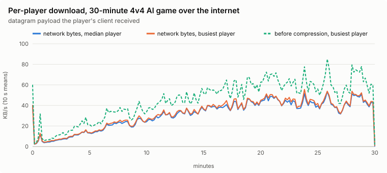
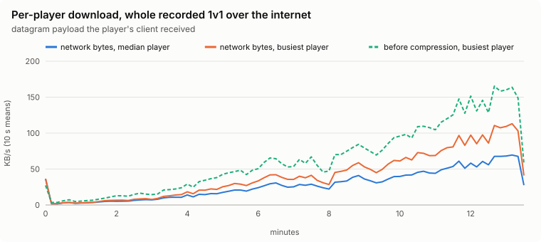
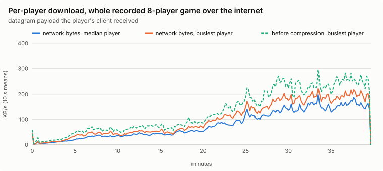
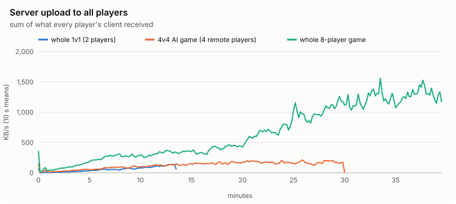
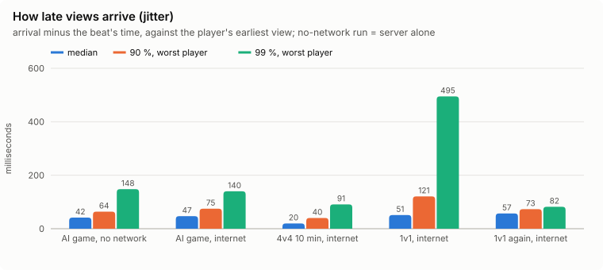
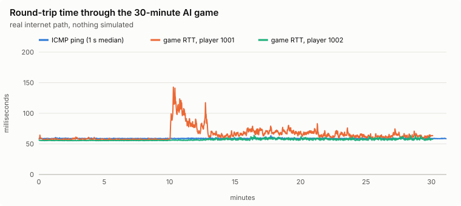
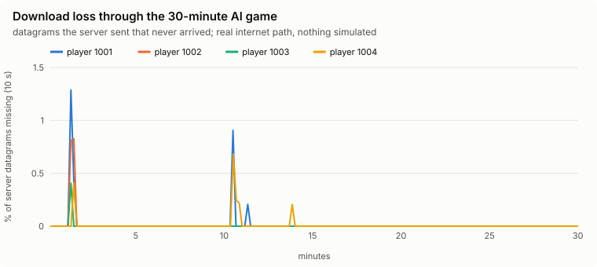
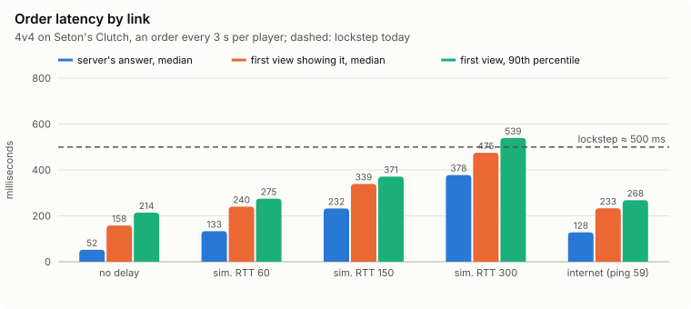
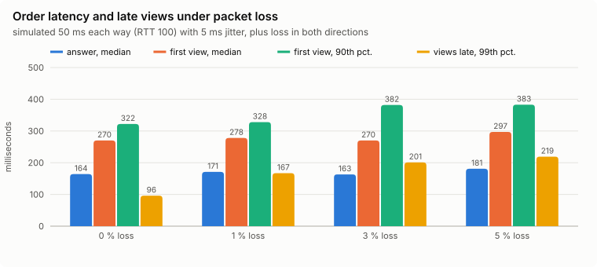

# Dedicated server: network measurements

Measured on 2026-11-15 on master (`9a1ccbc43`); the test player changes these runs needed are in `ae8637b10`, `8a2b8bb73` and `9a1ccbc43`, and the replay seat mode's compression fix in `5b039f406`. The commands to repeat every run are at the end.

The document has two parts, and they must not be mixed up:

- **Part 1, real games over the real internet.** Nothing is simulated: the server ran on a rented server in a data centre, the players connected over a home internet connection, and every delay, jitter and loss figure is what that path did.
- **Part 2, simulated links.** Server and players on one Linux machine at home, with delay, jitter and loss added on purpose by the test player, to see what worse connections than ours would do.

## Summary

**Real games over the internet** (ping 58.7 ms, home connection to a data centre server):

- **Throughput grows with the game.** Per player: a 30-minute 4v4 AI game 31.5 KB/s mean and 55.5 KB/s in its busiest 10 seconds (9 KB/s in the first five minutes, 42-45 KB/s in the last); a whole recorded 1v1 28.7 KB/s mean, 113 KB/s in its busiest 10 seconds; a whole recorded 8-player game 82.6 KB/s mean, 223 KB/s in its busiest 10 seconds (1.8 Mbit/s). What a player sends is under 1 KB/s.
- **The server's upload is what scales:** 661 KB/s on average for the 8-player game, 1,560 KB/s (12.5 Mbit/s) in its busiest 10 seconds.
- **Order latency: about RTT + 170 ms.** In the AI game the first view showing an order came after 234 ms (median), 271 ms (90 %) and 345 ms (99 %), over 2,176 orders; the same game with no network gave 165 ms. Lockstep takes about 500 ms.
- **Jitter and loss on this path were small.** In the AI game 21 of 339,686 server datagrams never arrived (0.006 %), all in a few short bursts, and none arrived out of order. Views came 47 ms late at the median and 140 ms at the 99th percentile, against 42 and 148 ms for the same game with no network: the internet added about 5 ms at the median. Every view of every run decoded and no player had to rejoin.

**Simulated links** (one machine, delay and loss added by the test player):

- Order latency follows RTT one for one: 158 ms with no delay, 240 ms at RTT 60, 339 ms at 150, 475 ms at 300 (medians). Lockstep takes about 500 ms whatever the RTT, so the server is faster up to about RTT 300 ms. At RTT 50, 100 and 150 ms the server showed an order in 224, 266 and 330 ms (medians), against about 550 ms for lockstep.
- At 5 % loss each way the median order still showed in 297 ms (270 ms with no loss); the 99th percentile of late views went from 96 to 219 ms. Every view decoded.

**Problems found:** a server listening on all addresses on a machine with two addresses answered from the wrong one and no player could join; the replay test mode sent uncompressed streams (fixed in `5b039f406`); a 2-CPU server can't run a late 8-player game at full speed (61 s behind over 40 minutes); twice, one player's connection had an RTT of 140-287 ms for three to five minutes while the others on the same connection stayed near 60 ms (cause unknown; a third run had none).

## Terms

| Term | Meaning here |
|---|---|
| Beat | One simulation step. Normal speed is 10 beats a second, so a beat is 100 ms. |
| View | What the server sends one player each beat: only what that player's team may see. |
| Test player | `faf_server_probe`. It joins the server like a game client, decodes every view, checks it against the server's checksums, and can give orders. It draws nothing, so latency figures leave out a real client's frame time and view buffer. |
| RTT | Round-trip time to the server and back. "Ping" is the same measured with ICMP. "Game channel RTT" is measured by the game's own connection on its datagrams. |
| Order latency | Per order: how many beats until the server ran it; time until the server's answer arrived; time until the first view showing the order on the unit arrived. |
| Download / upload | Datagram payload per second as the player's connection counted it (without 28 bytes of IP and UDP headers per datagram). "Before compression" is the same views decoded. |
| Views late (jitter) | Each view's arrival time minus its beat's time (beat number × 100 ms), measured against the earliest such offset the player saw. It is how much a client must buffer to show beats evenly. It includes both network jitter and unevenness in the server's own beat timing; the no-network baseline run shows the server's part alone. |
| Download loss | Server datagrams that never arrived: sequence numbers the player's connection skipped and never filled. |
| Upload loss | The share of the player's own datagrams its connection counted lost (orders, acks of views, keepalives). This count keeps a loss even when a late ack later shows the datagram arrived, so it reads high. |

## Setup

| | Real internet runs (Part 1) | Simulated runs (Part 2) |
|---|---|---|
| Server | rented server in a data centre: 2 virtual CPUs, 3 GB, capped at 1.9 CPUs and 2 GB | a Linux machine at home, pinned to 2 CPUs to match |
| Players | test players on the home machine, all behind the one home connection and NAT | test players on the same machine |
| Path | home ISP to the server's data centre: 6 hops, ICMP ping 58.7 ms median | loopback (no network); delay, jitter and loss added by each test player |
| Measured alongside | ICMP ping every 0.2 s from the home machine to the server; `mtr` route trace | - |

**The games:**

| Run | Game | Players measured | Length |
|---|---|---|---|
| AI game | 4v4 on Seton's Clutch: four test players (two a team) each teamed with AIs, four AIs fighting. Teams share their vision, so each test player receives everything its AI allies see and fight. Victory set to sandbox so the game runs its full length. Each test player orders a unit every 3 s while it has one. Played over the internet and, as the baseline, on the home machine with no network. | 4 | 30 minutes (18,000 beats) |
| Whole 1v1 | recorded FAF 1v1 26930624, replayed through the server with the real players' commands; played twice | 2 | 8,191 beats (14 minutes) |
| Whole 8-player game | recorded FAF 8-player game 26928802, replayed the same way | 8 | 23,202 beats (39 minutes) |
| 10-minute 4v4 | 4v4 on Seton's Clutch as above but normal victory, orders every 3 s; over the internet, and for every simulated link | 4 | 10 minutes |
| Recorded 12-player game | FAF game 26935800, before the compression fix (only in the earlier loss matrix) | 12 | first 10 minutes |

**Did the 2-CPU server keep up?** Yes in every internet run but the 8-player game: the AI game ran 30:00 of game time in 30:02 and its slowest beat took 50 ms of the 100 available; the 10-minute 4v4 ran 10:00 in 10:02 (slowest beat 25 ms); the two 1v1 runs had 6 and 3 of 8,191 beats late. So their latency figures are network plus normal server work, not an overloaded server.

**What Part 2 simulated, exactly:** each test player runs a relay in its own process between itself and the server. Every datagram, in both directions, is dropped at random with the set probability (each datagram independently), or else held for the set delay plus a random extra between 0 and the jitter value (uniform), then passed on. Datagrams can overtake each other. No bandwidth limit was set. A setting of "30 ms each way, 3 ms jitter" gives an RTT of about 63 ms.

# Part 1: real games over the internet

Nothing in this part is simulated.

## Throughput

| Game | Players | Download per player, mean (KB/s) | Busiest 10 s, 95th pct. / max over players (KB/s) | Before compression, mean (KB/s) | Upload per player, mean (KB/s) | Server upload, mean / busiest 10 s (KB/s) |
|---|---|---|---|---|---|---|
| 4v4 AI game, 30 min, internet | 4 | 31.5 | 49.7 / 55.5 | 44.1 | 0.71 | 125 / 214 |
| 4v4, 10 min, internet | 4 | 15.9 | 27.8 / 29.1 | 23.7 | 0.74 | 62 / 109 |
| whole recorded 1v1, internet | 2 | 28.7 | 107.4 / 113.1 | 44.9 | 0.52 | 57 / 139 |
| whole recorded 1v1 again, internet | 2 | 28.7 | 107.5 / 113.0 | 44.9 | 0.53 | 57 / 139 |
| whole recorded 8-player game, internet | 8 | 82.6 | 200.1 / 222.5 | 104.0 | 0.78 | 661 / 1560 |
| *for comparison: the same AI game, no network* | 4 | 30.0 | 45.3 / 56.7 | 41.9 | 0.66 | 120 / 223 |

The first 40 s (joining and the first whole view of the map) are left out of these figures. "Server upload" sums only the measured players: in the AI game the AIs need no views, so a 4v4 with eight remote players would need about twice as much. The internet and no-network AI games needed the same bandwidth (31.5 and 30.0 KB/s): the path did not change what was sent, only how it arrived.









**What drives it.** Traffic grows as units pile up: in the recorded 8-player game the median player received 11 KB/s in the first five minutes and about 150 KB/s in the last ten. Animated bones (poses) were about 70 % of a late 1v1's bytes when measured on 2026-11-11. Players in the same game can need very different bandwidth, because each receives only what their team sees: in the 1v1 one player's download rose from 8 KB/s in the first minute to 97 KB/s in the last, while the other's stayed at 24 KB/s or less. Compression saves less in big games: 36 % of the bytes over the whole 1v1, 20.5 % over the whole 8-player game (19 % in its last ten minutes).

**Connection a player needs.** From the busiest 10 seconds: about 1 Mbit/s down for a 1v1 and about 2 Mbit/s down for an 8-player game, under 0.1 Mbit/s up. The server needs about 12.5 Mbit/s up for the busiest stretch of an 8-player game.

## Jitter, loss and RTT

| Run | Players | Views late, median / 90 % / 99 % / worst (ms) | Game channel RTT, median / 99 % / worst (ms) | Download: server datagrams lost, of received (worst 1 s) | Download: datagrams out of order | Upload: share counted lost, mean / worst second (%) | ICMP ping median / 99 % / worst (ms), lost | Views, failed to decode | Rejoins |
|---|---|---|---|---|---|---|---|---|---|
| 30-min 4v4 AI game, internet | 4 | 47 / 75 / 140 / 542 | 60.2 / 110.1 / 165.5 | 21 of 339,686 (0.006 %; worst 1 s 8.3 %) | 0 (0.000 %) | 0.11 / 12.5 | 58.7 / 61.2 / 93.9, 1 of 9316 lost | 72004, 0 | 0 |
| 10-min 4v4, internet | 4 | 20 / 40 / 91 / 351 | 62.0 / 82.0 / 140.1 | not recorded | not recorded | 0.19 / 12.1 | 58.7 / 60.2 / 66.3, 0 of 3688 lost | 24008, 0 | 0 |
| whole recorded 1v1, internet | 2 | 51 / 121 / 495 / 1186 | 64.1 / 265.6 / 286.8 | not recorded | not recorded | 0.67 / 11.7 | 58.8 / 61.2 / 73.7, 0 of 4416 lost | 16400, 0 | 0 |
| whole recorded 1v1 again, internet | 2 | 57 / 73 / 82 / 119 | 69.3 / 70.5 / 71.6 | 0 of 65,094 (0.000 %) | 0 (0.000 %) | 0.07 / 12.1 | 58.8 / 61.3 / 66.0, 0 of 4418 lost | 16400, 0 | 0 |
| whole recorded 8-player game, internet | 8 | see below | 62.2 / 137.2 / 247.4 | not recorded | not recorded | 0.17 / 12.5 | 58.7 / 60.9 / 74.1, 0 of 12201 lost | 185616, 0 | 0 |
| *for comparison: the same AI game, no network* | 4 | 42 / 64 / 148 / 255 | 9.3 / 11.5 / 12.9 | not recorded | not recorded | 0.03 / 11.3 | no network | 72004, 0 | 0 |

"Views late" takes, per run, the median of the players' medians and the worst player's 90 %, 99 % and worst. Download loss and reordering were recorded only by the test player built during these runs, so only the AI game and the second 1v1 have them. The 1v1 was played twice to see whether the first run's RTT episode repeats; the game and its traffic were identical (28.7 KB/s per player both times). In the 8-player game the server fell a minute behind real time (see Problems found), so its "views late" (median 64 ms, worst 62 s) measures the server, not the network; its RTT and ICMP columns are the network figures.







**Reading these together.**

- **Jitter.** On this path the network added little: the AI game's views came 47 ms late at the median over the internet and 42 ms with no network at all, and the 99th percentiles were 140 and 148 ms. Most of the lateness is the server's own beat timing on 2 CPUs (a beat took up to 50-60 ms late in the game). The internet showed in the worst case (542 against 255 ms), during the short episodes below.
- **Loss.** The game's own traffic lost 21 of 339,686 server datagrams in the AI game, in two bursts (around minutes 1.5 and 10.5) and a few single seconds; a player lost datagrams in only 1 to 6 of its roughly 1,750 seconds. ICMP lost 1 of 9,316 pings. Nothing arrived out of order. The server machine's own send queue dropped nothing during the runs.
- **Upload loss reads high.** The upload column counts a datagram lost before a late ack can prove it arrived. With no network at all it still showed 11.3 % in its worst second, and in the second 1v1 12.1 % while not one download datagram was lost, so its worst-second figures are this counting, not real loss.
- **RTT episodes affect one flow, not the path.** At minute 10 of the AI game one player's game RTT jumped to about 140 ms and took about three minutes to settle, while another player's RTT and the ICMP ping stayed at 57-60 ms. The first whole 1v1 had a similar five-minute episode on one of its two flows; the same game played again an hour later had none (RTT 66 and 70 ms every minute, no loss, views at most 119 ms late). All flows came from the same machine through the same home connection, and even in quiet periods two flows differed by a steady 4 ms, so the provider seems to carry different flows differently. The cause of the episodes was not found.

## Order latency in the AI game

| Run | Orders seen | Server ran it, beats later (median) | Server's answer, median / 90 % / 99 % (ms) | First view showing it, median / 90 % / 99 % / worst (ms) |
|---|---|---|---|---|
| AI game, internet | 2176 of 2189 | 2 | 126 / 162 / 222 | 234 / 271 / 345 / 455 |
| *AI game, no network* | 1876 of 1882 | 1 | 57 / 108 / 138 | 165 / 220 / 289 / 385 |

The internet added 69 ms to the median, a little more than one game-channel RTT (60 ms). Each test player sends an order every 3 s while it has a unit left; when the AIs killed a test player's last unit its orders stopped, which is why the totals differ between runs. Every order the server answered was applied.

# Part 2: simulated links

Everything in this part ran on one machine over loopback. The delay, jitter and loss are artificial, added by the test players as described under Setup.

## Latency against RTT



| Link | Game channel RTT, median (ms) | Server ran it, beats later (median) | Server's answer, median / 90 % (ms) | First view showing it, median / 90 % / 99 % / worst (ms) | Orders seen |
|---|---|---|---|---|---|
| no delay | 10 | 1 | 52 / 107 | 158 / 214 / 312 / 321 | 192 of 196 |
| simulated 30 ms each way, 3 ms jitter | 65 | 2 | 133 / 171 | 240 / 275 / 366 / 373 | 192 of 196 |
| simulated 75 ms each way, 8 ms jitter | 160 | 3 | 232 / 265 | 339 / 371 / 439 / 449 | 192 of 196 |
| simulated 150 ms each way, 15 ms jitter | 316 | 4 | 378 / 424 | 475 / 539 / 611 / 619 | 192 of 196 |
| for comparison, real internet (Part 1, 10-min 4v4) | 61 | 2 | 128 / 166 | 233 / 268 / 303 / 358 | 768 of 780 |

Where the time goes, from the no-delay row: the server runs an order at the start of the next beat, so an order waits 0-100 ms (median answer 52 ms with a 10 ms RTT). The view of that beat is built when the beat ends and sent then (first view 158 ms). The RTT adds on top one for one: the first-view median minus the RTT is 148-179 ms in every row. The simulated 60 ms RTT and the real 59 ms path gave nearly the same result (240 and 233 ms).

The orders not seen were sent at or after beat 6,000, when the game had already stopped. Every order the server answered was applied (1,536 answers in these runs, none refused or dropped).

## Lockstep against the server at RTT 50, 100 and 150 ms

| Simulated link, each way | Game channel RTT, median (ms) | Server: first view showing an order, median / 90 % / 99 % (ms) | Lockstep: a beat's issue until it is shown, averages over 100 beats (ms) |
|---|---|---|---|
| none | 10 | 157 / 209 / 220 | 506-545 |
| 25 ms, 3 ms jitter | 55 | 224 / 257 / 272 | 501-516 |
| 50 ms, 5 ms jitter | 107 | 266 / 320 / 377 | 502-569 |
| 75 ms, 8 ms jitter | 160 | 330 / 368 / 445 | 500-512 |

Server: the 10-minute 4v4 of Part 2, run on 2026-11-15 with each of the four test players on its own link in the same game; 193 orders seen per player, every one of the 6,001 views decoded and all 751 checksum checks matched for each player, and the server kept real time (10:00 of game time in 10:01). Lockstep: measured on 2026-11-10 with two clients of this engine in a 1v1 on Seton's Clutch through a relay that delayed each direction by the same amount; there the RTT is the delay set on the link, not one measured in the game. Lockstep's figure starts when a beat is issued, and an order first waits for the next beat (0-100 ms), so its order latency is about 50 ms more on average: about 550 ms. The `net_Lag` of 500 ms covers any RTT below it, which is why lockstep's figure does not change with the RTT.

At every RTT measured, the server shows an order in 30-60 % of the time lockstep takes: 224 against about 550 ms at RTT 50, 266 at 100, 330 at 150.

## Loss



Simulated 50 ms each way (RTT about 105 ms) with 5 ms jitter, plus random loss of each datagram in both directions.

| Simulated loss each way | Upload loss the connection counted, mean (%) | First view showing an order, median / 90 % / 99 % (ms) | Views late, median / 99 % / worst (ms) | Views decoded |
|---|---|---|---|---|
| 0 % | 0.0 | 270 / 322 / 404 | 23 / 96 / 164 | 6002, 0 failed |
| 1 % | 1.6 | 278 / 328 / 439 | 25 / 167 / 274 | 6000, 0 failed |
| 3 % | 3.9 | 270 / 382 / 470 | 34 / 201 / 377 | 6002, 0 failed |
| 5 % | 7.0 | 297 / 383 / 491 | 29 / 219 / 481 | 6002, 0 failed |

A lost datagram is resent and later views wait behind it, so loss stretches the tail while the median barely moves. The earlier matrix (2026-11-10, a 12-player game, before compression) went further: at 300 ms and 5 % loss views came up to 2.3 s late, a 2 s cut in the link was bounded by the cut (2.1-2.4 s worst), and no player disconnected.

# Problems found

1. **Listening on all addresses fails on a server with two addresses.** The rented server has two public addresses on one interface. The game server listened on `0.0.0.0`; its answers left from the machine's default address, not the one the players sent to, and the home NAT dropped them. The server received 1,356 datagrams and no player joined. Binding `--listen` to the public address worked around it. The network code had no way to answer from the address a datagram arrived on. Fixed later the same day, with IPv6 support (issue #160): a server listening on all addresses (`0.0.0.0` or `[::]`) on Linux now answers each player from the address the player sent to; a regression test sends to 127.0.0.3 on a server listening on all addresses and fails without the fix.
2. **The replay test mode sent uncompressed streams.** `headless --seats-listen` built its network without the server's compression level, so it measured about 25 % more bytes than decoded views instead of about a third fewer. Fixed in `5b039f406`; the recorded 12-player run in the earlier loss matrix ran before the fix.
3. **2 CPUs are not enough for a late 8-player game.** The rented server fell behind real time in the recorded 8-player game: 2,555 of 23,202 beats late and 61.1 s lost over 2,381 s. That is why that run's "views late" reaches a minute: the views were on time for a game that ran slow. The capacity test of 2026-11-04 (about 4 games per core on bigger machines) still stands; a 2-CPU machine is small.
4. **One flow's RTT can be much worse than another's on the same path.** In the whole 1v1 one player's RTT reached 287 ms (per-minute medians 183, 252, 175, 126, 110 ms, then 59-77 ms); the other player, on the same machine and NAT, stayed at 62-66 ms, and ICMP ping stayed at 58.8 ms median. The same game played again an hour later had no episode, and the AI game had a shorter one on one flow at minute 10. The game recovered each time without a rejoin. The episode in the AI game cost the affected player little: its 60 orders during those three minutes showed after 248 ms (median, worst 455 ms), against 234 ms for its other 521 orders.

# What these runs do not cover

- **Real game clients.** The test players decode everything a client decodes but draw nothing; a Windows client's frame time and its view buffer come on top of the latency figures.
- **Players far away or in many places.** The only real path was one home connection to one server 59 ms away. All test players shared that connection and NAT. Longer and worse paths were only simulated.
- **Human players in the AI game.** The test players' own armies stood idle apart from their orders; their teams' AIs did the fighting.
- **The lobby** (FAF sign-in, lobby, launch). The game traffic measured here is the same after launch; the lobby itself was not measured.
- **A real second machine on the LAN, and Windows.** Every non-internet figure is one Linux machine over loopback; the server and test players ran on Linux only.
- **12- and 16-player games over the internet**, and the server's CPU at full scale.

# How to rerun

Build `server`, `headless` and `faf_server_probe` on Linux (preset `linux-clang-x64-release`; `faf_server_probe` is `EXCLUDE_FROM_ALL`, so name it as a target). On the server machine, `--data` is a folder with the FAF game data, maps and, for replays, the `.scfareplay` files.

**A match with test players** (the AI game and the 10-minute 4v4). The match file is a Lua file with `MatchSeed`, `MatchTokens` (one token per player uid) and `MatchConfig` (`GameOptions` and `PlayerOptions`, as FAF's lobby writes them). The AI game used `ScenarioFile = '/maps/scmp_009/scmp_009_scenario.lua'`, `Victory = 'sandbox'`, `MatchSeed = 5151`, human seats with `OwnerID` 1001-1004 on teams 2, 2, 3, 3 and four `AIPersonality = 'adaptive'` AIs, two on each team.

```sh
server --match match4v4ai.lua --out <dir> --data <data> --listen <the server's public address>:27250 \
  --join-seconds 90 --timeout 38 --stop-beat 18000 --status-minutes 0.25 /simworkers 1 /nobugreport /nosound
# on each player's machine, one per uid:
faf_server_probe --server <address>:27250 --uid 1001 --token <its token> --seconds 1900 \
  --beat-ms 100 --rate-every 1 --order-at 25 --order-every 3
```

These runs used the server's own public address in `--listen`, as `0.0.0.0` failed then (Problems found, 1); with that fixed, `0.0.0.0` or `[::]` work too. For the 10-minute 4v4 use normal victory, `--stop-beat 6000` and `--seconds 700`.

**A recorded game** (the whole 1v1 and 8-player game): the replay's players' commands drive the game, and each test player takes one seat (uid 0, 1, ...) with the token `seat-<uid>` and no orders of its own.

```sh
headless --replay <data>/replays/<id>.scfareplay --seats --seats-listen <address>:27251 \
  --view-pipeline 2 --pace 100 --timeout <minutes> /init <data>/faf/bin/init_replay.lua /nobugreport /nosound /simworkers 1
faf_server_probe --server <address>:27251 --uid 0 --token seat-0 --seconds <n> --beat-ms 100 --rate-every 1
```

**Simulated links**: add `--latency-ms <each way>`, `--jitter-ms <n>` and `--loss <percent>` to a test player. Each test player can have its own link in the same game.

The test player prints a rate line every second (`--rate-every 1`: bytes, wire in and out, RTT, loss, datagrams received, missing and reordered), one line per order and a summary of the orders at exit. The figures in this document are percentiles over those lines.
