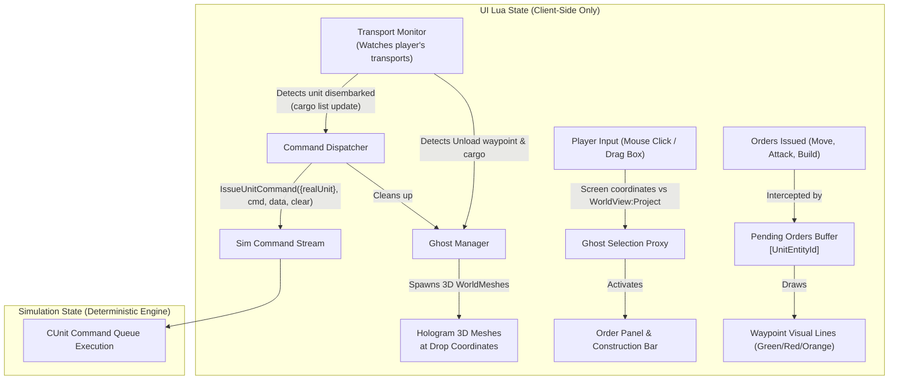

# Design Spec: Transport Unload Ghost Units & Queued Orders

- **Date:** 2026-11-07
- **Branch:** `feat/transport-unload-ghosts`
- **Scope:** FAF UI Lua (`data/fafengine/lua` / `lua/ui/game/`)
- **Compatibility:** 100% Retail Engine Compatible (`ForgedAlliance.exe` + `faf-re`)

---

## 1. Problem Statement & Motivation

In *Supreme Commander: Forged Alliance*, aerial transport drops (sniping commanders, flanking artillery drops, engineer expansions) require heavy micro-attention lock:
1. The player orders an air transport to move and drop units at an enemy base or remote location.
2. While the transport is in flight, the player must either watch the flight path (neglecting economy, radar, and base defense) or risk dropped units idling under defensive fire after landing.
3. Units currently inside transport cargo retain their state (`UNITSTATE_Attached`), but the stock engine's `SelectUnits` function explicitly redirects selection to the parent transport, preventing players from selecting cargo units and issuing pre-orders.

**Goal:** Allow players to select virtual "ghost" silhouettes of units at planned unload locations, pre-queue movement, combat, and engineering orders, and have those orders execute seamlessly as soon as each unit disembarks.

---

## 2. Design Principles & Hard Constraints

1. **Zero Desync Risk (Sim Isolation):**
   - The entire ghost management system, screen projections, 3D `WorldMesh` rendering, and order buffering must live strictly within the **UI Lua state** (`/lua/ui/game/`).
   - The simulation state (`Sim`) is untouched until units physically detach on the ground.
2. **Retail Engine Compatibility:**
   - Works on unmodded `ForgedAlliance.exe` binaries as well as `faf-re`.
   - Uses standard FAF UI components (`/lua/ui/controls/worldmesh.lua`, `WorldView:Project`, `IssueUnitCommand`).
3. **No Special Selection Filters:**
   - Ghosts behave like normal units: click selects a ghost, drag-box selects ghosts alongside or instead of other units.
   - Support for both individual ghost selection and full drop-group selection.
4. **Scope of Commands:**
   - Tactical commands: Move, Attack-Move, Attack Target, Patrol, Guard.
   - Support & Engineering: Assist, Reclaim, Capture, and full Construction queue (factories, radars, defenses) for engineers/Commanders.
5. **Transports Scope:**
   - Applies strictly to the player's own transports (`focusArmy == transport:GetArmy()`).

---

## 3. Architecture & Subsystems

### 3.1. Ghost Manager (`drop_ghosts_manager.lua`)
- **Detection:**
  - Hooked into UI game tick or selection updates (`gamemain.lua` / `orders.lua`).
  - Iterates player's transports.
  - Queries `transport:GetCommandQueue()` to find waypoints of type `Unload`.
  - Queries `transport:GetCargo()` to list `UserUnit`s currently boarded.
- **Visuals (`WorldMesh`):**
  - For each boarded unit, retrieves its unit blueprint (`GetUnitBlueprintByName(unit:GetBlueprint().BlueprintId)`).
  - Creates a `WorldMesh` utilizing the unit's `.scm` mesh and albedo texture with transparent hologram shading (`FakeRings` or alpha-tinted material).
  - Positions ghosts in a circular/radial landing formation centered at the drop point.
  - Automatically updates ghost positions if the player moves or drags the unload waypoint.
  - Destroys ghosts immediately if the transport is destroyed, killed, or the `Unload` command is cancelled/cleared.

### 3.2. Ghost Selection & UI Proxy (`drop_ghosts_selection.lua`)
- **Hit Testing & Box Selection:**
  - Hooked into `WorldView:OnWorldClick` and `WorldView:OnWorldDrag`.
  - Uses `WorldView:Project` to convert ghost world positions to screen coordinates.
  - Normal click or marquee drag selects the ghost(s).
  - Displays standard unit selection brackets / selection deciles around selected ghosts.
- **Panel Synchronization:**
  - Updates the bottom Order Bar (`orders.lua`) with available abilities of the selected ghost(s).
  - If an engineer or Commander ghost is selected, updates the Construction Panel (`construction.lua`) with the blueprints available to that unit tier.

### 3.3. Command Buffer & Waypoint Visualizer (`drop_ghosts_orders.lua`)
- **Queue Storage:**
  - Maintains `PendingDropOrders[unitEntityId] = { orders = { ... } }`.
  - Left-click on orders / Right-click in world:
    - Without Shift: clears previous pending orders for this unit and sets new order.
    - With Shift: appends to the pending queue.
  - Waypoints:
    - Renders color-coded order paths from the ghost's landing coordinate to the target point/unit:
      - Green for Move / Attack-Move.
      - Red for Attack Target.
      - Orange for Construction & Assist.
      - Yellow for Patrol.

### 3.4. Execution Dispatcher
- Detects when a unit is unloaded:
  - Listens to cargo removal on the transport (`transport:GetCargo()`), or engine unload event.
- For the detached `realUnit`:
  - Retrieves buffered orders from `PendingDropOrders[realUnit:GetEntityId()]`.
  - Iterates and issues each order via `IssueUnitCommand({realUnit}, commandType, data, false)`.
  - Removes the ghost `WorldMesh` and clears buffered orders.

---

## 4. Edge Cases & Handling

1. **Transport Destroyed in Flight:**
   - Detects `transport:IsDead()` or absence from session.
   - Cleans up all `WorldMesh` instances and pending orders immediately. Zero orphaned memory.
2. **Unload Order Cancelled / Overridden:**
   - Player issues `Stop` or a new command replacing `Unload`.
   - Ghosts and pending queues are discarded cleanly.
3. **Target Destroyed Before Landing:**
   - If a target entity (enemy radar, building, wreck) is destroyed before landing, the native engine command processor automatically skips the invalid command upon dispatch.
4. **Multiple Drops (Partial Unloads):**
   - Transports with multiple sequential unload waypoints associate ghosts with the specific waypoint that drops them.

---

## 5. Automated Testing & Verification Plan

### 5.1. Unit Test Suite (`tests/lua/test_drop_ghosts.lua`)
- **T1: Queue Buffering:** Add single command, append via Shift, verify FIFO order.
- **T2: Waypoint Drag:** Shift waypoint by offset `(dx, dy, dz)`, verify ghost origin updates.
- **T3: Transport Death:** Simulate transport death event, assert all ghost tables and meshes are destroyed.
- **T4: Command Formatting:** Verify payload structure passed to `IssueUnitCommand` matches stock engine specifications.

### 5.2. Integration Scenario Test (`tools/scenarios/drop-ghosts-smoke.yaml`)
- Spawns transport with 1 tank and 1 engineer inside cargo.
- Issues `Unload` command at remote position.
- Simulates ghost selection and command queuing (Move for tank, Build Radar for engineer).
- Asserts that upon landing, tank moves toward waypoint and engineer initiates construction.
- Asserts zero engine desync / zero Lua runtime errors.